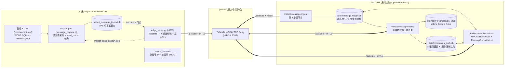

# 技术开发与架构规范文档（Technical Development & Architecture Specification）

> **适用版本**：MaiBot `1.3.19`（分支 `feat/embodied-shujuku-v1`）
> **最后更新**：2026-11-08

---

## 一、 系统总体架构与节点拓扑

本系统在 MaiBot（Maisaka 推理内核与 `PlatformIOManager` 统一平台抽象）基础上，构建了面向真实 Android Root 设备的微信原生全模态采集、后台 Hook 发送、结构化真值记忆库（`companion_vault`）与多模态上下文就地挂载体系。

### 1. 节点拓扑与通信链路



### 2. 代码目录职责划分

| 目录路径 | 架构分层 | 核心职责 |
| :--- | :--- | :--- |
| [`src/phone_edge/`](../../src/phone_edge/) | 手机边缘层 | 运行于小米 10 `/data/adb/maibot_edge/`。负责 Frida 注入守护、WCDB 提交态采集与后台发送（`message_capture.js`）、Root HTTP 服务（`edge_server.py`）、媒体解析与转码（`message_media.py`）、发送幂等与限流账本（`send_ledger.py`）、看门狗保活（`edge_watchdog.py`）。 |
| [`src/device_services/`](../../src/device_services/) | 设备基础服务层 | 运行于小米 10 `/data/adb/device_services/`。负责屏幕低亮度常亮守护（`display.py`）与校园网 SRUN 门户自动重连认证（`campus.py`, `srun.py`）。 |
| [`src/platform_io/wechat/`](../../src/platform_io/wechat/) | 微信平台驱动层 | 运行于 `DMIT-US`。负责将手机日记账同步至 `message_ledger.db`（`message_ingestor.py`）、解析引用结构（`message_quotes.py`）、游标消费与坏消息隔离（`ledger_source.py`）、生成原生 `SessionMessage` 封包（`projection.py`）、对接 `PlatformIOManager` 收发消息（`driver.py`, `edge_client.py`）。 |
| [`src/companion_vault/`](../../src/companion_vault/) | 真值记忆与资产层 | 运行于 `DMIT-US`。负责 8 张真值表管理（`truth_db.py`）、会话级 RBAC 权限校验（`access_policy.py`）、通讯录与群成员同步（`group_members.py`）、后台多表 SQL 记忆整合（`consolidator.py`）、消息媒体异步拉取入库（`message_media_worker.py`）、历史多模态原件就地挂载与引用召回（`wechat_recall.py`, `quote_recall.py`, `runtime_bridge.py`）。 |
| [`src/maisaka/`](../../src/maisaka/) | 推理与工具核心层 | Maisaka Planner / Replyer 循环（`reasoning_engine.py`, `runtime.py`）、历史上下文构建（`context/messages.py`）、内置工具与绿灯装载（`builtin_tool/reply.py`）。 |
| [`pytests/companion/`](../../pytests/companion/) | 专项测试套件 | 覆盖账本同步、媒体解析、群成员与私聊 RBAC 隔离、SQL 记忆巩固、引用召回、驱动迁移与通配符多会话路由的端到端单元测试。 |

---

## 二、 手机边缘层（`src/phone_edge/`）设计规范

### 1. WCDB 提交态采集与单写者日记账（`message_capture.js` & `message_daemon.py`）
- **版本指纹强校验**：`message_daemon.py` 在注入前校验微信 `8.0.79 (3200)` 的 `libWCDB.so` SHA256（`2ff2b9dfa31da533c0265ccf9d79fe392c4f6b019b0783693d087934e5e65353`）与 Tinker Patch APK SHA256（`d0fbb514273f380a9a9579be44d46f504366c2f623e862188f30c6083caa9a80`）。若微信意外升级导致哈希不匹配，拒绝注入并告警，严禁盲目 Hook 未知偏移。
- **非侵入提交态读取**：Frida 脚本仅在 `SQLiteDatabase.insertWithOnConflict` / `updateWithOnConflict` 返回成功后触发异步扫描提示，绝不篡改微信入参、返回值或源数据库 `EnMicroMsg.db`。
- **四级扫描对账机制**：
  1. **增量新行扫描**：按 `msgId > lastMaxId` 每批 200 行拉取新消息；
  2. **定点 ID 复查**：针对刚插入或刚更新的 `msgId` 集合立即复查 `message` 与辅助表（`ImgInfo2`、`voiceinfo`、`videoinfo2`、`appattach`）；
  3. **近期窗口复查**：定期复查最近 100 条消息，捕获撤回（`type=268445456` / `10000`）与缩略图/原图状态更新；
  4. **全表滚动巡检**：按游标每轮扫描 200 行历史消息，确保较早消息的修订最终一致。
- **单写者原则**：`/data/user/0/com.tencent.mm/files/maibot_message_journal.db` 仅由微信进程内的 `message_capture.js` 写入（WAL 模式），`edge_server.py` 始终通过 `?mode=ro` 只读查询 `message_events`、`send_outbox` 与 `group_members_snapshot`，彻底杜绝多进程写锁冲突与 SELinux/UID 权限污染。

### 2. 后台无 UI 文本发送与双层限流（`ISendMsgMgr` Hook + `SendLedger`）
- **上层业务控制器调用**：
  `message_capture.js` 通过 `Java.cast(Java.use('no3.w1').a(), Java.use('rt5.i5')).Jj(chatId, content, msgType, 0)` 调用微信内部 `MicroMsg.SendMsgMgr`（实现 `ISendMsgMgr` 接口 `no3.c1`）。该入口不依赖前台 `ChattingUI`，支持手机息屏、处于桌面或停留在任意其他界面时向任意 `wxid_*` 或 `*@chatroom` 发送消息。
- **原子 Spool 投递与崩溃恢复**：
  1. `edge_server.py` 收到 `POST /wechat/send_text` 后，先在 `SendLedger`（`send_ledger.py`）校验 `request_id` 幂等性、目标会话合法性（支持 `MAIBOT_ALLOWED_SEND_CHATS="*"`）及滑动窗口限流；
  2. 执行拟人打字延迟 `compute_typing_delay_ms(text)`（按字数加随机抖动 `800ms ~ 10000ms`）；
  3. 将指令写入 `/data/user/0/com.tencent.mm/files/maibot_send_spool/<request_id>.json`；
  4. `message_capture.js` 先在 `send_outbox` 持久化 `status='queued'` 后再删除 Spool 文件（防止崩溃丢单），调用 `Jj()` 后置为 `status='sending'`，并在启动时自动执行 `recoverInterruptedSends()` 恢复未决任务；
  5. `pollActiveSends()` 在 `EnMicroMsg.db` 中观测到 `isSend=1 AND talker=chatId AND msgId > maxMsgIdBefore AND status=2 AND msgSvrId > 0` 后，更新 `send_outbox.status='confirmed'` 并返回真实 `msg_id` 与 `msg_svr_id`。
- **双层滑动窗口防封限流**：
  - **单会话限流**：同一 `chat_id` 每分钟最多发送 `max_sends_per_chat_per_minute`（默认 3 条）；
  - **全局账号限流**：全账号每分钟最多发送 `max_sends_per_minute`（默认 6 条）；
  - 触发限流时边缘端返回 `HTTP 429 (status="rate_limited")`，云端 `WeChatEdgeClient` 自动进入串行排队退避（`rate_limit_wait_seconds=65.0s` + 随机抖动）并复用同一 `request_id` 重试，绝不丢弃回复或重复发包。

### 3. 通讯录与群成员全量导出（`scanGroupMembers`）
- `message_capture.js` 每 60 秒（以及启动时）从 `EnMicroMsg.db` 读取：
  - `chatroom` 表：所有 `*@chatroom` 的 `memberlist` 与 `displayname`；
  - `rcontact` 表：所有非系统联系人的 `username`、`nickname`、`conRemark`（备注名）与 `alias`，以特殊键 `group_id = '__contacts__'` 存入 `group_members_snapshot`。
- 云端通过 `GET /wechat/group_members` 拉取后，由 [`apply_directory_snapshot`](../../src/companion_vault/group_members.py) 自动更新 `companion_truth.db` 的 `group_members` 表与 `person_info` 表（自动补全好友昵称与微信备注，但**绝不自动授予 `OWNER` 权限**，新联系人默认 `trust_role='GROUP_MEMBER'`）。

### 4. 原生媒体解析与 `WxGF` / `SILK` 无损转码（`message_media.py`）
- **图片与动画表情（`kind=3` / `kind=47`）**：
  - 根据 `ImgInfo2`、`WxFileIndex3` 与消息 XML 中的路径/MD5/长度定位 `/data/media/0/Android/data/com.tencent.mm/MicroMsg/<account>/image2/` 或 `/data/data/com.tencent.mm/MicroMsg/<account>/emoji/` 下的文件。
  - 若文件头为微信私有 `wxgf` 容器，自动定位内嵌的 HEVC（H.265）VPS 起始码 `\x00\x00\x00\x01\x40`，剥离私有头部后调用 `/data/data/com.termux/files/usr/bin/ffmpeg -f hevc` 解码为标准 PNG（表情）或高清 JPEG（图片）返回云端。
- **语音（`kind=34`）**：
  - 定位 `voice2/` 下的 `.amr`（`#!SILK_V3`），保留 `.amr` 原件的同时解码为单声道 24kHz 16-bit 无压缩 PCM `.wav`，供 Gemini 原生音频理解直接消费。

---

## 三、 微信平台驱动层（`src/platform_io/wechat/`）设计规范

### 1. 账本消费与坏消息隔离（`ledger_source.py`）
- **通配符游标（`chat_id = "*"`）**：
  `LedgerSource` 在 `wechat_driver_cursors` 中维护 `(source, account, "*", consumer)` 游标。首次启动（`backfill=False`）自动将游标对齐至 `message_revisions` 当前最大 `rowid`，确保服务部署或新增会话时绝不重放历史消息风暴。
- **持久化确认边界（P1 可靠性保障）**：
  `WeChatRootDriver.deliver_committed` 仅在 `PlatformIOManager.accept_inbound` 完成会话路由与业务入队后才调用 `LedgerSource.mark_delivered` 写入 `wechat_driver_delivered` 并推进游标。
- **坏消息隔离（Quarantine）**：
  若单条消息因未知发送者或畸形字段触发 `ValueError` / `KeyError` / `json.JSONDecodeError`，`LedgerSource.consume_once` 将其记录至 `wechat_driver_quarantine` 表并推进游标，防止单条坏消息永久阻塞后续正常聊天。

### 2. 多会话路由与系统账号过滤（`driver.py`）
- **`is_supported_wechat_chat_id(chat_id)`**：
  当 `allowed_chats = ["*"]` 时，允许所有正常好友（`wxid_*` 或自定义微信号）与群聊（`*@chatroom`），同时硬性过滤 `weixin`、`notifymessage`、`fmessage`、`medianote`、`floatbottle`、` filehelper`、`gh_*`（公众号）及 `@openim` 等系统伪账号。
- **私聊与群聊双栈出站路由**：
  `WeChatRootDriver.send_message` 按优先级依次解析目标会话 ID：
  1. `message.message_info.group_info.group_id`（群聊）
  2. `additional_config["platform_io_target_group_id"]`
  3. `additional_config["platform_io_target_user_id"]`（私聊目标用户，由 `send_service` 注入）
  4. `message.message_info.user_info.user_id`

---

## 四、 结构化真值库与全模态召回层（`src/companion_vault/`）设计规范

### 1. 8 张核心真值表（`truth_db.py`）

| 层级 | 表名 | 主键 | 注入与召回策略 |
| :--- | :--- | :--- | :--- |
| **L1 常驻层** | `global_state` | `row_id=1` | 每轮 Planner 全量注入：时间、地点、设备状态。 |
| **L1 常驻层** | `user_status` | `key` | 常驻注入用户高频状态（群聊仅暴露 `visibility='PUBLIC'`）。 |
| **L1 常驻层** | `quests_events` | `quest_code` (`QTxxxx`) | 常驻注入 `status='PENDING'` 的约定与待办。 |
| **L2 绿灯层** | `chronicle_events` | `code_index` (`AMxxxx`) | Planner 阶段注入 `summary + trigger_when` 目录；Replyer 阶段按 `memory_greenlights` 或会话作用域装载 `chronicle_text + key_dialogue`。 |
| **L2 绿灯层** | `media_vault` | `file_code` (`FMxxxx`) | Planner 阶段注入当前会话授权的最近 20 个文件目录（含 `msg_id`）；Replyer 阶段按 `file_greenlights` 重新挂载二进制/URI。 |
| **L2 绿灯层** | `person_info` | `person_id` | Planner 阶段注入 `one_line_intro`；Replyer 阶段按 `person_greenlights` 装载详细 `impression`。 |
| **L2 绿灯层** | `app_sop_skills` | `sop_id` | 手机端标准操作 SOP 目录。 |
| **L3 状态层** | `phone_surfing_log` | `surf_code` (`SFxxxx`) | 仅暴露 `is_shared=0` 的冲浪记录，点亮后自动置 `is_shared=1`。 |

### 2. 会话级 RBAC 与 SQL 沙箱隔离（`access_policy.py` & `consolidator.py`）
- **访问控制矩阵（[`allowed_conversations`](../../src/companion_vault/access_policy.py)）**：
  - **群聊会话（`*@chatroom`）**：仅允许读取本群（`{destination_chat_id}`）产生的记忆（`memory_provenance`）与媒体原件（`message_asset_links`），**绝对禁止读取任何私聊或其他群聊的数据**。
  - **私聊会话（`wxid_*`）**：允许读取该私聊自身及该好友所在共同群聊（查询 `group_members` 表）的记忆与附件。
- **SQL 巩固沙箱（[`_build_scoped_consolidation_db`](../../src/companion_vault/consolidator.py)）**：
  后台记忆巩固模型生成的 `table_sql` **不在全量真值库上直接裸跑**，而是先在仅包含当前会话可见行集的独立内存 SQLite 快照上执行，校验通过后再将新增/更新行与 `memory_provenance` 溯源记录在 `BEGIN IMMEDIATE` 事务中原子回写主库，彻底杜绝通过 `INSERT ... SELECT` 跨私聊窃取数据的风险。

### 3. 多模态原件就地挂载与消息顺序保证（`wechat_recall.py` & `reasoning_engine.py`）
- **自适应等待（`_wait_for_media_jobs`）**：
  当最新 4 条消息包含图片、表情、语音或文件时，推理引擎在进入 Planner 前最多等待 8 秒（每 200ms 轮询 `message_media_jobs`），确保刚收到的媒体完成手机拉取与转码。
- **原位挂载（[`hydrate_wechat_history_media_async`](../../src/companion_vault/wechat_recall.py)）**：
  - 对当前历史窗口中最近 `max_hydrated`（默认 12）条微信消息，按消息原始 `msg_id` 顺序将已验证（`state='ready'` 且未被撤回）的原件描述符直接写入对应 `SessionBackedMessage.vault_descriptors`；
  - 滑出窗口的更早消息自动卸载二进制载荷（保留文本占位与 `FMxxxx` 目录索引），兼顾多模态时序精准度与上下文 Token 预算；
  - 在 [`SessionBackedMessage.to_ planner_context_item`](../../src/maisaka/context/messages.py) 中，每条消息按 **`[时间/发送者/消息头与正文] -> [紧跟该消息的 vault_descriptors 原件图片/音频/PDF Part]`** 原位展开，不再将媒体堆叠在上下文末尾。

---

## 五、 插件开发与能力扩展规范（基于 `maibot-plugin-sdk` v2）

在扩展新能力（如 VPS 沙盒执行 + 动态子域名挂载 + 微信发送限时链接）时，应遵循以下规范：
1. **组件选型**：
   - 使用 `@Tool` 暴露给 Maisaka Planner；
   - 耗时 `<2s` 的轻量渲染任务同步返回 URL；
   - 耗时 `>2s` 的重计算沙盒任务立即返回 `task_id`，后台完成后通过 `self.ctx.maisaka.append_context` 与 `self.ctx.maisaka.trigger_proactive` 唤醒 Planner 主动发送链接；
   - 如需以机器人人设撰写长文，调用宿主能力 `maisaka.reply.generate`（[`DocumentReplyGenerator`](../../src/chat/replyer/document_generator.py)）。
2. **微信原件鉴权**：
   - 插件处理微信附件（`FMxxxx`）时，必须读取宿主在 `@Tool` 调用中自动注入的 `group_id` / `user_id`，并通过 [`authorized_file_rows`](../../src/companion_vault/access_policy.py) 验证当前会话对该文件的访问权限。

---

## 六、 测试与代码质量门禁

在提交代码或发布上线前，必须在仓库根目录通过以下检查：

```bash
# 1. 运行具身微信与真值库全套回归测试（69+ 项）
pytest pytests/companion/ -q

# 2. 运行平台适配器策略与 Maisaka 推理引擎测试
pytest pytests/platform_io/test_adapter_policy.py pytests/maisaka/test_reasoning_engine.py -q

# 3. 静态语法与字节码编译检查
python3 -m compileall -q src/companion_vault src/platform_io/wechat src/phone_edge src/device_services
```
