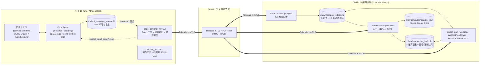

# 技术开发与架构规范文档（Technical Development & Architecture Specification）

> **适用版本**：MaiBot `1.3.19`（活跃开发分支 `feat/twins-st-preset-engine`，生产主干 `main` @ `9b054f781`）
> **最后更新**：2026-11-13

---

## 一、 系统总体架构与节点拓扑

本系统在 MaiBot（Maisaka 推理内核与 `PlatformIOManager` 统一平台抽象）基础上，构建了面向真实 Android Root 设备的微信原生全模态采集、后台 Hook 发送、结构化真值记忆库（`companion_vault`）与多模态上下文就地挂载体系。

### 1. 节点拓扑与通信链路



### 2. 代码目录职责划分

| 目录路径 | 架构分层 | 核心职责 |
| :--- | :--- | :--- |
| [`src/phone_edge/`](../../src/phone_edge/) | 手机边缘层 | 运行于小米 10 `/data/adb/maibot_edge/`。负责 Frida 注入守护、WCDB 提交态采集与后台发送（`message_capture.js`）、Root HTTP 服务（`edge_server.py`）、媒体解析与转码（`message_media.py`）、发送幂等与限流账本（`send_ledger.py`）、看门狗保活（`edge_watchdog.py`）。 |
| [`src/device_services/`](../../src/device_services/) | 设备基础服务层 | 运行于小米 10 `/data/adb/device_services/`。负责屏幕低亮度常亮守护（`display.py`）与校园网 SRUN 门户自动重连认证（`campus.py`, `srun.py`）。 |
| [`src/platform_io/wechat/`](../../src/platform_io/wechat/) | 微信平台驱动层 | 运行于 `DMIT-US`。负责将手机日记账同步至 `message_ledger.db`（`message_ingestor.py`）、解析引用结构（`message_quotes.py`）、游标消费与坏消息隔离（`ledger_source.py`）、生成原生 `SessionMessage` 封包（`projection.py`）、对接 `PlatformIOManager` 收发消息（`driver.py`, `edge_client.py`）。 |
| [`src/companion_vault/`](../../src/companion_vault/) | 真值记忆与资产层 | 运行于 `DMIT-US`。负责 8 张真值表管理（`truth_db.py`）、会话级 RBAC 权限校验（`access_policy.py`）、通讯录与群成员同步（`group_members.py`）、后台多表 SQL 记忆整合（`consolidator.py`）、消息媒体异步拉取入库（`message_media_worker.py`）、历史多模态原件就地挂载与引用召回（`wechat_recall.py`, `quote_recall.py`, `runtime_bridge.py`）。 |
| [`src/maisaka/`](../../src/maisaka/) | 推理与工具核心层 | Maisaka Planner / Replyer 循环（`reasoning_engine.py`, `runtime.py`）、上下文确定性降级压缩（`context/compaction.py`）、历史多模态原位构建（`context/messages.py`）、内置工具与绿灯装载（`builtin_tool/reply.py`）。 |
| [`plugins/embodied_workspace/`](../../plugins/embodied_workspace/) | 动态工作区与沙盒插件层 | 基于 `maibot-plugin-sdk` v2 的全栈交付系统：统一慢轨构建桥接（`cli_bridge.py`）、Bubblewrap + cgroups v2 资源配额（`resource_quota.py`）、Scale-to-Zero 后端监管（`backend_supervisor.py`）、单级泛域名路由与四级免登网关（`subdomain_router.py`, `gateway_server.py`）、外部 Git 时光机（`time_machine.py`）、全双工实时协作总线（`realtime_hub.py`）与算力经济监控（`compute_economy.py`）。 |
| [`plugins/st_preset_engine/`](../../plugins/st_preset_engine/) | 酒馆预设与双子叙事 WebUI 插件层 | 基于 MaiBot v2 原生 `@HomeCard` 与 `webui.json`（`schema_version: 2`），提供首页状态卡片、顶部工作区概览页及侧边栏 SillyTavern 预设在线编辑、互斥条目切换、双子动态叙事约束配置与 Dry-Run 编译预览工作台。 |
| [`pytests/companion/`](../../pytests/companion/) | 专项测试套件 | 覆盖账本同步、媒体解析、群成员与私聊 RBAC 隔离、SQL 记忆巩固、引用召回、内联音频多模态回退、驱动迁移、具身工作区 Phase 1~4 以及 `STPresetEngine` 与原生插件 WebUI 的端到端单元测试。 |

---

## 二、 手机边缘层（`src/phone_edge/`）设计规范

### 1. WCDB 提交态采集与单写者日记账（`message_capture.js` & `message_daemon.py`）
- **版本指纹强校验**：`message_daemon.py` 在注入前校验微信 `8.0.79 (3200)` 的 `libWCDB.so` SHA256（`2ff2b9dfa31da533c0265ccf9d79fe392c4f6b019b0783693d087934e5e65353`）与 Tinker Patch APK SHA256（`d0fbb514273f380a9a9579be44d46f504366c2f623e862188f30c6083caa9a80`）。若微信意外升级导致哈希不匹配，拒绝注入并告警，严禁盲目 Hook 未知偏移。
- **非侵入提交态读取**：Frida 脚本仅在 `SQLiteDatabase.insertWithOnConflict` / `updateWithOnConflict` 返回成功后触发异步扫描提示，绝不篡改微信入参、返回值或源数据库 `EnMicroMsg.db`。
- **四级扫描对账机制**：
  1. **增量新行扫描**：按 `msgId > lastMaxId` 每批 200 行拉取新消息；
  2. **定点 ID 复查**：针对刚插入或刚更新的 `msgId` 集合立即复查 `message` 与辅助表（`ImgInfo2`、`voiceinfo`、`videoinfo2`、`appattach`）；
  3. **近期窗口复查**：定期复查最近 100 条消息，捕获撤回（`type=268445456` / `10000`）与缩略图/原图状态更新；
  4. **全表滚动巡检**：按游标每轮扫描 200 行历史消息，确保较早消息的修订最终一致。
- **单写者原则**：`/data/user/0/com.tencent.mm/files/maibot_message_journal.db` 仅由微信进程内的 `message_capture.js` 写入（WAL 模式），`edge_server.py` 始终通过 `?mode=ro` 只读查询 `message_events`、`send_outbox` 与 `group_members_snapshot`，彻底杜绝多进程写锁冲突与 SELinux/UID 权限污染。

### 2. 后台无 UI 文本与原生引用消息发送（`ISendMsgMgr` & `AppMsgLogic` Hook + `SendLedger`）
- **常规文本发送（`ISendMsgMgr` Hook）**：
  `message_capture.js` 通过 `Java.cast(Java.use('no3.w1').a(), Java.use('rt5.i5')).Jj(chatId, content, msgType, 0)` 调用微信内部 `MicroMsg.SendMsgMgr`（实现 `ISendMsgMgr` 接口 `no3.c1`）。该入口不依赖前台 `ChattingUI`，支持手机息屏、处于桌面或停留在任意其他界面时向任意 `wxid_*` 或 `*@chatroom` 发送消息。
- **原生引用回复（`AppMsgLogic:k0.I` + `nx0.r` AppMsg 57 消息卡片）**：
  - **微信引用底层机制**：微信 Android 8.0.79 的引用回复并非纯文本拼接，而是标准的 AppMsg（库表 `type=822083633`，AppMsg 内部 `type=57`）。XML 内包含完整 `<refermsg>` 节点，涵盖被引用消息的全局唯一 `svrid`、来源会话 `fromusr`、原发送者 `chatusr`、原发送者昵称/备注 `displayname`、原消息摘要 `content` 与时间戳 `createtime`。
  - **逆向反编译关键路径与底层签名**：
    - 数据模型反序列化：`Java.use('nx0.r').v(xml)` 解析 XML 并自动实例化 `com.tencent.mm.plugin.msgquote.model.MsgQuoteItem`（`na5.a`）至 AppMsg 的 `x2` 字段。
    - XML 规范与账号绑定：XML 根部 `<fromusername>` **必须传入当前登录微信号的真实 `wxid`**（通过 `SELECT value FROM userinfo WHERE id=2` 动态获取，如 `wxid_w5d0efdxczt322`），绝不可传入 32 位 MicroMsg 目录 MD5 哈希，否则会导致鉴权失败。
    - 无 UI 发送分发与正确参数签名：
      底层方法完整签名为：
      ```java
      public static Pair<Integer, Long> com.tencent.mm.pluginsdk.model.app.k0.I(
          nx0.r appMsg,
          String appId,        // 必须传 ""（应用ID，非第三方App场景为空）
          String appName,      // 必须传 ""（应用名）
          String toUser,       // 目标会话 chatId（好友 wxid_* 或群聊 *@chatroom）
          String mediaTagName, // 必须传 ""
          byte[] data          // 必须传 null
      )
      ```
      > [!IMPORTANT]
      > **核心参数位置防坑踩点**：目标接收者 `chatId` **必须作为第 4 个参数（`toUser`）传入**，调用形式为 `k0.I(appMsg, "", "", chatId, "", null)`！若错误将 `chatId` 误传给第 2 个参数 `appId`，微信内部异步 Kotlin 协程任务 `ru.d`（继承自 `ev.j`）在 `prepare` 阶段将因收件人为空报错 `retCode: -520012`，在 `updateMsg` 阶段报错 `retCode: -520009`（`UpdateMsgError`），上报日志 `report32784`，消息将完全无法写入数据库。
    - 异步协程返回与回执捕获：
      `k0.I` 调用后在主线程入队一个异步协程（`ru.d`），立即返回 `Pair(0, null)`，其 `pair.second` 为 `null`。因此出站账本不能依赖同步返回值中的 `localMsgId`，而是通过 `pollActiveSends()` 记录调用前的 `maxMsgIdBefore` 水位线；当协程将消息写入 `message` 表（`type=822083633, status=1`）并通过网络 CGI 发送成功（`status=2` 且生成 `msgSvrId`）时，增量水位线扫描捕获并完成回执闭环，端到端完整耗时仅约 **600ms**。
  - **云端解析与端到端闭环（`driver.py` & `edge_client.py`）**：
    - 当 Maisaka Planner 产出带 `ReplyComponent` 的回复时，`WeChatRootDriver._resolve_quote_target` 提取 `target_message_id`（如 `#wechat:scope:account:143229`），从 `message_ledger.db` 查询原始 `server_id`、`body`、`updated_at_ms`，并从 `companion_truth.db` 的 `person_info` 表匹配 `wechat_remark` 与 `person_name`。
    - 组装标准 quote 元数据后通过 `POST /wechat/send_quote` 投递至手机端 `edge_server.py`，经原子 Spool 入队并由 Frida 脚本无 UI 调度 `k0.I` 原生出站，彻底解决微信端仅展示孤立纯文本气泡而丢失引用卡片的问题。
- **原子 Spool 投递与崩溃恢复**：
  1. `edge_server.py` 收到 `POST /wechat/send_text` 或 `POST /wechat/send_quote` 后，先在 `SendLedger`（`send_ledger.py`）校验 `request_id` 幂等性、目标会话合法性（支持 `MAIBOT_ALLOWED_SEND_CHATS="*"`）及滑动窗口限流；
  2. 执行拟人打字延迟 `compute_typing_delay_ms(text)`（按字数加随机抖动 `800ms ~ 10000ms`）；
  3. 将指令写入 `/data/user/0/com.tencent.mm/files/maibot_send_spool/<request_id>.json`（包含 `msg_type: "quote"` 与完整 `quote` 节点）；
  4. `message_capture.js` 先在 `send_outbox` 持久化 `status='queued'` 后再删除 Spool 文件（防止崩溃丢单），调用 `k0.I()` 或 `Jj()` 后置为 `status='sending'`，并在启动时自动执行 `recoverInterruptedSends()` 恢复未决任务；
  5. `pollActiveSends()` 在 `EnMicroMsg.db` 中观测到 `isSend=1 AND talker=chatId AND msgId > maxMsgIdBefore AND status=2 AND msgSvrId > 0`（或匹配 `k0.I` 返回的 `localId`）后，更新 `send_outbox.status='confirmed'` 并返回真实 `msg_id` 与 `msg_svr_id`。
- **双层滑动窗口防封限流**：
  - **单会话限流**：同一 `chat_id` 每分钟最多发送 `max_sends_per_chat_per_minute`（默认 3 条）；
  - **全局账号限流**：全账号每分钟最多发送 `max_sends_per_minute`（默认 6 条）；
  - 触发限流时边缘端返回 `HTTP 429 (status="rate_limited")`，云端 `WeChatEdgeClient` 自动进入串行排队退避（`rate_limit_wait_seconds=65.0s` + 随机抖动）并复用同一 `request_id` 重试，绝不丢弃回复或重复发包。

### 3. 通讯录与群成员全量导出（`scanGroupMembers`）
- `message_capture.js` 每 60 秒（以及启动时）从 `EnMicroMsg.db` 读取：
  - `chatroom` 表：所有 `*@chatroom` 的 `memberlist` 与 `displayname`；
  - `rcontact` 表：所有非系统联系人的 `username`、`nickname`、`conRemark`（备注名）与 `alias`，以特殊键 `group_id = '__contacts__'` 存入 `group_members_snapshot`。
- 云端通过 `GET /wechat/group_members` 拉取后，由 [`apply_directory_snapshot`](../../src/companion_vault/group_members.py) 自动更新 `companion_truth.db` 的 `group_members` 表与 `person_info` 表（自动补全好友昵称与微信备注，但**绝不自动授予 `OWNER` 权限**，新联系人默认 `trust_role='GROUP_MEMBER'`）。

### 4. 原生媒体解析与 `WxGF` / `SILK` 无损转码（`message_media.py`）
- **图片与动画表情（`kind=3` / `kind=47`）**：
  - 根据 `ImgInfo2`、`WxFileIndex3` 与消息 XML 中的路径/MD5/长度定位 `/data/media/0/Android/data/com.tencent.mm/MicroMsg/<account>/image2/` 或 `/data/data/com.tencent.mm/MicroMsg/<account>/emoji/` 下的文件。
  - 若文件头为微信私有 `wxgf` 容器，自动定位内嵌的 HEVC（H.265）VPS 起始码 `\x00\x00\x00\x01\x40`，剥离私有头部后调用 `/data/data/com.termux/files/usr/bin/ffmpeg -f hevc` 解码为标准 PNG（表情）或高清 JPEG（图片）返回云端。
- **语音（`kind=34`）**：
  - 定位 `voice2/` 下的 `.amr`（`#!SILK_V3`），保留 `.amr` 原件的同时解码为单声道 24kHz 16-bit 无压缩 PCM `.wav`，供 Gemini 原生音频理解直接消费。

---

## 三、 微信平台驱动层（`src/platform_io/wechat/`）设计规范

### 1. 账本消费与坏消息隔离（`ledger_source.py`）
- **通配符游标（`chat_id = "*"`）**：
  `LedgerSource` 在 `wechat_driver_cursors` 中维护 `(source, account, "*", consumer)` 游标。首次启动（`backfill=False`）自动将游标对齐至 `message_revisions` 当前最大 `rowid`，确保服务部署或新增会话时绝不重放历史消息风暴。
- **持久化确认边界（P1 可靠性保障）**：
  `WeChatRootDriver.deliver_committed` 仅在 `PlatformIOManager.accept_inbound` 完成会话路由与业务入队后才调用 `LedgerSource.mark_delivered` 写入 `wechat_driver_delivered` 并推进游标。
- **坏消息隔离（Quarantine）**：
  若单条消息因未知发送者或畸形字段触发 `ValueError` / `KeyError` / `json.JSONDecodeError`，`LedgerSource.consume_once` 将其记录至 `wechat_driver_quarantine` 表并推进游标，防止单条坏消息永久阻塞后续正常聊天。

### 2. 多会话路由与系统账号过滤（`driver.py`）
- **`is_supported_wechat_chat_id(chat_id)`**：
  当 `allowed_chats = ["*"]` 时，允许所有正常好友（`wxid_*` 或自定义微信号）与群聊（`*@chatroom`），同时硬性过滤 `weixin`、`notifymessage`、`fmessage`、`medianote`、`floatbottle`、` filehelper`、`gh_*`（公众号）及 `@openim` 等系统伪账号。
- **私聊与群聊双栈出站路由**：
  `WeChatRootDriver.send_message` 按优先级依次解析目标会话 ID：
  1. `message.message_info.group_info.group_id`（群聊）
  2. `additional_config["platform_io_target_group_id"]`
  3. `additional_config["platform_io_target_user_id"]`（私聊目标用户，由 `send_service` 注入）
  4. `message.message_info.user_info.user_id`

### 3. 人设多态性与三层身份解耦机制（`projection.py` & `truth_db.py`）
为支持用户随时在 WebUI 切换 Profile（人设卡）或修改名字设定，系统构建了**平台物理身份与认知身份解耦的三层模型**：
1. **三层身份分工**：
   - **平台物理层（Physical Platform Layer）**：由底层微信号（`self_wxid`，如 `wxid_w5d0efdxczt322`）作为不可变基石；全局昵称（`userinfo id=4`）与各群名片（`chatroom.displayname`）构成外部视角；
   - **投影路由层（Projection & Routing Layer）**：[`projection.py`](../../src/platform_io/wechat/projection.py) 不再硬编码任何名字常量，通过 `get_bot_self_aliases()` 动态读取 `global_config.bot.nickname` 与 `alias_names` 维护 `name_to_wxid` 字典，确保无论艾特新旧人设名字还是底层 wxid 都能精确解析；
   - **认知与真值层（Cognitive & Truth Layer）**：以 `bot_config.toml` 为单一事实源，[`truth_db.py`](../../src/companion_vault/truth_db.py) 动态生成 `<自身账号与提及判定准则>`。
2. **认知层双重身份排他准则（Dual-Identity Perception）**：
   在上下文头部显式注入模型自我认知与排他防漂移规则：
   ```markdown
   <自身账号与提及判定准则>
   - 你的唯一核心名字/当前人设：{bot_name}{alias_prompt} | 你的底层微信ID：{self_wxid}
   - 提及(@)严格判定规则：仅当消息包含指向 '{self_wxid}' 的 @提及 或明确文本 {'@' + bot_name} / {'@' + alias} 时，才是在 @ 你本人。
   - 当消息中出现 '@其他名字'（例如 '@某群友' 等）时，那是群成员在 @ 群内的其他群友（可通过下方<重要角色索引>核对其微信昵称与备注名的对应关系），绝不是你的底层代号，切勿将他人的微信昵称误认为自己！
   - 如果群内有群友昵称与你相似或重名，以底层微信ID及下方<重要角色索引>为准，严禁将他人发言视作对你的指令。
   </自身账号与提及判定准则>
   ```
3. **多 Profile 无缝热更新**：
   用户在 WebUI 切换人设时，系统热重载配置并即时刷新别名映射和身份 Prompt 准则，零重启无缝切换；同时建议在实体微信群中同步更新“我在本群的昵称”，保持界面物理对称。

---

## 四、 结构化真值库与全模态召回层（`src/companion_vault/`）设计规范

### 1. 8 张核心真值表（`truth_db.py`）

| 层级 | 表名 | 主键 | 注入与召回策略 |
| :--- | :--- | :--- | :--- |
| **L1 常驻层** | `global_state` | `row_id=1` | 每轮 Planner 注入：东京叙事时钟、地点、设备状态、双子槽位（`active_persona_slot` / `elder_away_arc`）及算力工况（群聊隐藏精确美元账单）。 |
| **L1 常驻层** | `user_status` | `key` | 常驻注入主人高频状态（强制 `PRIVATE` 与 `scope_chat_id` 绑定，仅 OWNER 私聊可见）。 |
| **L1 常驻层** | `quests_events` | `quest_code` (`QE`/`QT`) | 常驻注入 `status='ongoing'` 的约定与待办（群聊按 `scope_chat_id` 严格隔离，绝不跨群串台）。 |
| **L2 绿灯层** | `chronicle_events` | `code_index` (`AMxxxx`) | Planner 阶段注入 `summary + trigger_when` 目录；Replyer 阶段按 `memory_greenlights` 或会话作用域装载 `chronicle_text + key_dialogue`。 |
| **L2 绿灯层** | `media_vault` | `file_code` (`FMxxxx`) | Planner 阶段注入当前会话授权的最近 20 个文件目录（含 `msg_id`）；Replyer 阶段按 `file_greenlights` 重新挂载二进制/URI。 |
| **L2 绿灯层** | `person_info` | `person_id` | 物理拆分为 `public_impression`（公开社交印象）与 `owner_private_notes`（绝密金主/亲密档案，群聊 SQL 投影物理剔除）。 |
| **L2 绿灯层** | `app_sop_skills` | `sop_id` | 手机端标准操作 SOP 目录（仅 OWNER 私聊暴露）。 |
| **L3 状态层** | `phone_surfing_log` | `surf_code` (`SFxxxx`) | 含 `persona_slot` 双子分仓字段；仅暴露 `is_shared=0` 的冲浪记录，点亮后自动置 `is_shared=1`。 |

### 2. 四道物理级记忆隔离防线（Zero-Leak Architecture）
1. **防线一（`person_info` 物理分列 + SQL 投影级裁剪 + Authorizer 看守）**：
   - `truth_db.py` 将人物印象拆分为 `public_impression` 与 `owner_private_notes`；群聊巩固执行 `execute_table_sql(..., forbid_private_person_columns=True)` 时由 SQLite 内核级 `set_authorizer` 物理拦截对 `owner_private_notes` 的任何读写；`person_profile.py` 与 `query_person_profile.py` 采用 Fail-Closed 默认群聊策略，凡非 OWNER 私聊，SQL `SELECT` 列表物理剔除 `owner_private_notes` 与 `wechat_remark`。
2. **防线二（巩固提交期强制可见性降级锁）**：
   - `consolidator.py` 在私聊整合提交事务内，无论模型输出的 SQL 如何填写 `visibility`，均强制覆写 `user_status` / `quests_events` / `chronicle_events` 为 `visibility='PRIVATE'` 并绑定 `scope_chat_id`；群聊待办强制绑定本群 `scope_chat_id`，杜绝跨群广播。
3. **防线三（切断宿主 `A_memorix` 双写与私聊表达跨聊传染）**：
   - 微信平台收发链路与 `MemoryAutomationService` 物理旁路宿主原生 `A_memorix` 自动写回（支持 `MAIBOT_DISABLE_AMEMORIX=1` 启动级关闭）；`runtime.py` 与 `maisaka_expression_selector.py` 物理阻断微信私聊参与 `ExpressionLearner` / `JargonLearner` 采样及跨会话表达共享池。
4. **防线四（群聊出站硬机密锚点熔断 `output_guardrail.py`）**：
   - `send_service.py` 在群聊消息发往 `PlatformIOManager` 前调用 `check_group_outbound_text`，对精确美元余额特征串（如 `$x.xx USD`）及 `MAIBOT_GROUP_SECRET_ANCHORS` 配置词表执行出口熔断。

### 3. 多模态原件就地挂载、内联双通道回退与消息顺序保证（`wechat_recall.py`, `model_assets.py` & `quote_recall.py`）
- **自适应等待（`_wait_for_media_jobs`）**：
  当最新 4 条消息包含图片、表情、语音或文件时，推理引擎在进入 Planner 前最多等待 8 秒（每 200ms 轮询 `message_media_jobs`），确保刚收到的媒体完成手机拉取与转码。
- **原位挂载（[`hydrate_wechat_history_media_async`](../../src/companion_vault/wechat_recall.py)）**：
  - 对当前历史窗口中最近 `max_hydrated`（默认 12）条微信消息，按消息原始 `msg_id` 顺序将已验证（`state='ready'` 且未被撤回）的原件描述符直接写入对应 `SessionBackedMessage.vault_descriptors`；
  - 滑出窗口的更早消息自动卸载二进制载荷（保留文本占位与 `FMxxxx` 目录索引），兼顾多模态时序精准度与上下文 Token 预算；
  - 在 [`SessionBackedMessage.to_planner_context_item`](../../src/maisaka/context/messages.py) 中，每条消息按 **`[时间/发送者/消息头与正文] -> [紧跟该消息的 vault_descriptors 原件图片/音频/PDF Part]`** 原位展开，不再将媒体堆叠在上下文末尾。
- **内联多模态双通道与零延迟直通编码器（`asset_encoder.py`）**：
  - 核心载荷层（[`context_item.py`](../../src/llm_models/payload_content/context_item.py)）原生支持 `ContextAudioPart(audio_base64, mime_type, file_code)`，并在 Gemini（`Part.from_bytes`）、OpenAI Chat（`input_audio`）与 OpenAI Responses 客户端全栈打通。
  - `model_assets.py` 与 `quote_recall.py` 统一复用 [`asset_encoder.py`](../../src/companion_vault/asset_encoder.py)（`encode_media_part` / `encode_inline_descriptor`）：当配置 `MAIBOT_FILES_API_ENABLED=0`（对接不支持 Google Files API 的聚合网关如 `api.0-0.pro`）时，`<= 15MB` 的语音与原件直接走零延迟内联字节通道，彻底消除每次先发起 `/upload/v1beta/files` 触发 404 再异常回退的无效网络往返。

---

## 五、 动态工作区与全栈沙盒交付架构（`plugins/embodied_workspace/`）

系统通过 MaiBot v2 标准插件 `embodied_workspace`（叙事定位：「Fairy 工作区引擎」）提供长文杂志级排版、数据分析、交互式 WebApp 与受控临时后端交付能力（详见 [`docs/CLEANROOM_REFACTOR_SPEC.md`](../../docs/CLEANROOM_REFACTOR_SPEC.md)）：

1. **统一异步慢轨架构（Unified Slow Track）**：
   - 对外仅暴露 `@Tool("run_agent_workspace")`（支持 `task_type`：`document` | `webapp` | `backend`；`action`：`create` | `update`）与 `@Tool("manage_workspace_projects")`（支持 `list` | `history` | `rollback`），两者共用 `CLIBridge.project_lock` 异步互斥锁；外置标准构建规范模板 [`templates/FAIRY_AGENTS.md`](../../plugins/embodied_workspace/templates/FAIRY_AGENTS.md)。
   - **长程超时与多槽进度追踪**：沙盒构建超时上限默认 `10800s`（3 小时，支持 `>= 30s` 任意合法配置）。执行期间按 `self._active_jobs[job_id]` 多槽维护并发状态，每 `180s` 通过宿主原生 `maisaka.context.append` 与 `maisaka.proactive.trigger` 唤醒聊天模型按人设自然播报进展；`on_unload()` 自动取消并回收全部在途后台协程。
2. **净室沙盒隔离与确定性 cgroups v2 进程回收**：
   - **净室环境白名单（`bwrap --clearenv`）**：`build_sandbox_env()` 绝不复制宿主 `os.environ` 且源码零明文密钥，仅显式注入 `PATH`、`HOME=/tmp/home`、`TZ=Asia/Tokyo`、`PORT` 及 `FAIRY_SANDBOX_API_KEY` / `FAIRY_SANDBOX_BASE_URL`；授权微信原件按任务隔离硬链接至 `/tmp/workspace/inbox/<job_id>/`，任务结束即自动清理。
   - **确定性单元管控**：`ResourceQuotaWrapper` 使用 `--unit=maibot-fairy-...` 显式命名 `systemd-run --scope`，超时、空闲休眠或卸载时通过 `systemctl kill --kill-who=all <unit>.scope` 内核级原子清理整个进程树。
3. **单级泛域名网关、共享连接池与私享防串号免登体系**：
   - 本地网关（`:18790`）生命周期内复用单一 `aiohttp.ClientSession` 进行流式反代，使用 `Path.is_relative_to` 严格校验目录边界，支持 `issuer_name` 动态角色署名。
   - 私聊工作区链接对无 Cookie 访客默认提供**免登只读浏览**（转发分享给朋友绝不泄露创建者/OWNER 身份 Cookie）；`verify_cookie` 强校验 90 天服务端有效期（未配置 `cookie_secret` 时自动生成 32 字节随机密钥持久化至 `.cookie_secret`）；群聊 `whoami` 仅按本群 `group_members` 返回公开 `person_name`（物理屏蔽 `wechat_remark`），前端 SDK 全量采用 DOM `.textContent` 渲染杜绝 XSS。

---

## 六、 测试与代码质量门禁

在提交代码或发布上线前，可在 Windows（`.venv`）或 Linux / WSL 仓库根目录直接执行以下全量门禁（142 项测试 100% 通过）：

```bash
# 1. 运行具身微信、四道记忆防线、双子预留、撤回同步与工作区全套回归测试（142 项）
pytest pytests/companion pytests/platform_io/test_wechat_at_parsing.py pytests/platform_io/test_adapter_policy.py pytests/maisaka/test_reasoning_engine.py -q

# 2. Ruff 静态代码质量与安全规范检查
ruff check plugins/embodied_workspace src/companion_vault src/platform_io/wechat src/maisaka/memory/person_profile.py src/maisaka/builtin_tool/query_person_profile.py
```

---

## 七、 净室重构治理验收归档（v2.2 全三批次已清零闭环）

此前 v2.1 架构审计识别的全部历史技术债与安全红线均已按 [`docs/CLEANROOM_REFACTOR_SPEC.md`](../../docs/CLEANROOM_REFACTOR_SPEC.md) 在 Batch 1 ~ Batch 3 中完成根治并通过终审复核：

- **[已清零] P0 安全、状态一致性与配置契约**：
  - `P0-SEC-01`：源码明文密钥与固定 Cookie Secret 已彻底移除，实装 `bwrap --clearenv` 与 `.cookie_secret` 随机自举；
  - `P0-CONSISTENCY-02`：已打通 `LedgerSource` $\rightarrow$ `WeChatRootDriver.revoke_committed` $\rightarrow$ `MaisakaHeartFlowChatting.revoke_message` 实时剔除防抖队列与 `_chat_history` 撤回残影；
  - `P0-CONFIG-03`：已移除 `max(10800, ...)` 硬钳制，恢复 `cli_timeout_seconds >= 30s` 真实配置契约。
- **[已清零] P1 记忆隔离、Schema 单一事实源与插件契约**：
  - `LEAK-01 ~ LEAK-06`：四道物理级记忆防线（`person_info` 拆列 + Authorizer、提交期 `PRIVATE` 锁、切断微信 `A_memorix` 与私聊表达跨聊传染、`output_guardrail.py` 群聊出口熔断）已全线实装；
  - `P1-ISOLATION-02`：算力账本已提纯为 [`src/companion_vault/compute_ledger.py`](../../src/companion_vault/compute_ledger.py)，彻底废除插件运行期 `ALTER TABLE`；
  - `P1-SANDBOX-PLUGIN-05`：私聊只读分享防串号、本群公开昵称过滤、DOM `.textContent` 安全化、命名 cgroup 回收、`@Command` 命名捕获组与死代码（`fast_renderer.py` 等）清理全部完成。
- **[已清零] P2 去实例硬编码与遗留目录归档**：
  - 源码已剥离特定微信号/群友昵称/`143000` 魔数阈值，补齐 `tzdata` 跨平台依赖，并物理移除 `src/mobile_agent/` 与 `src/integration_tools/` 废弃目录。
