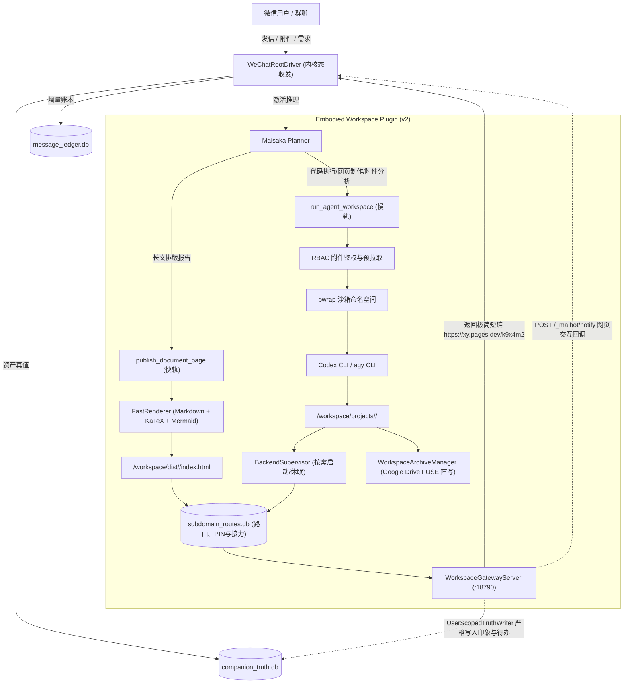
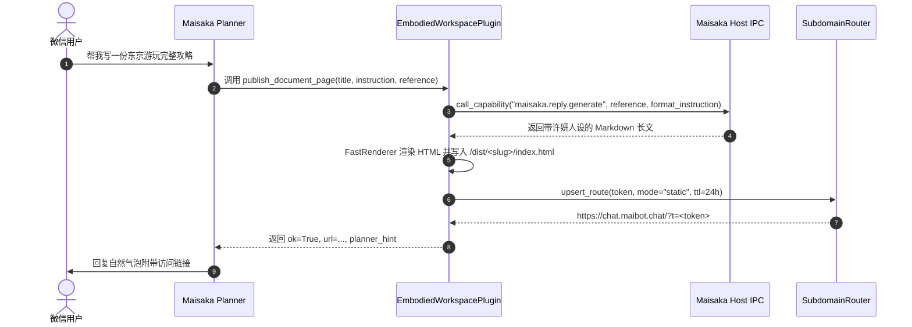
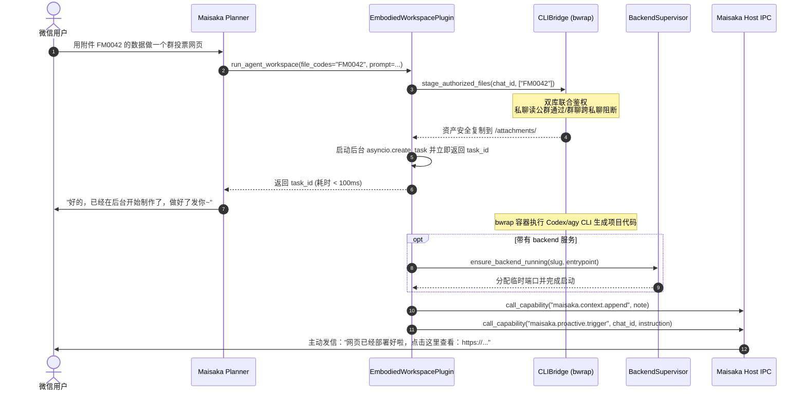
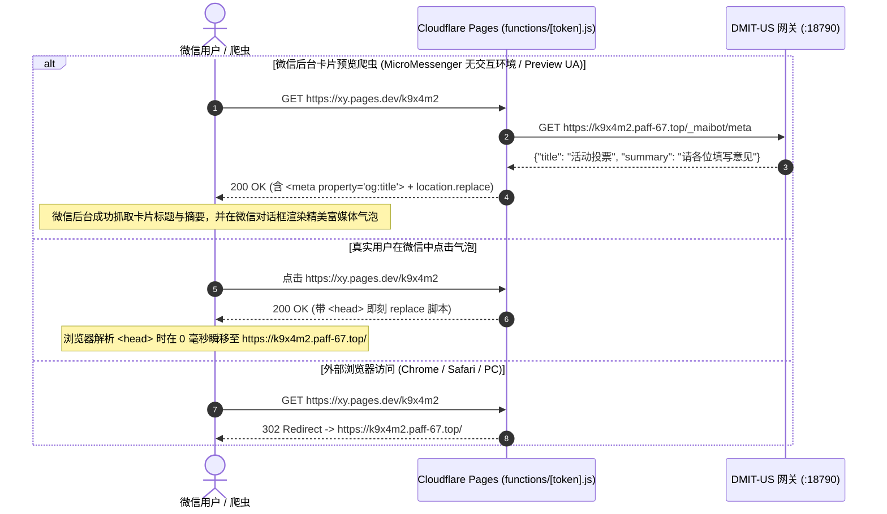
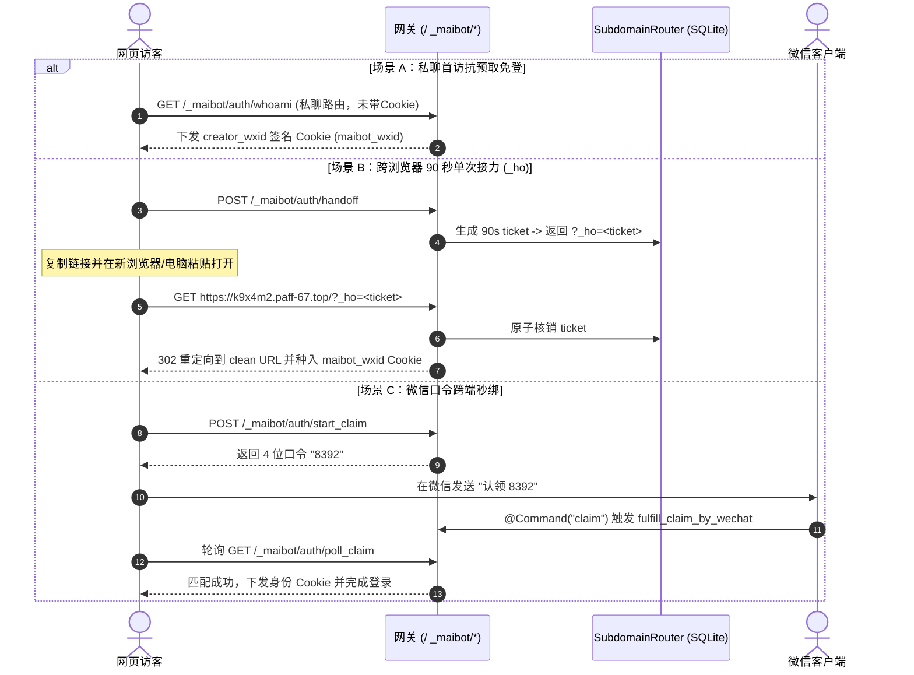
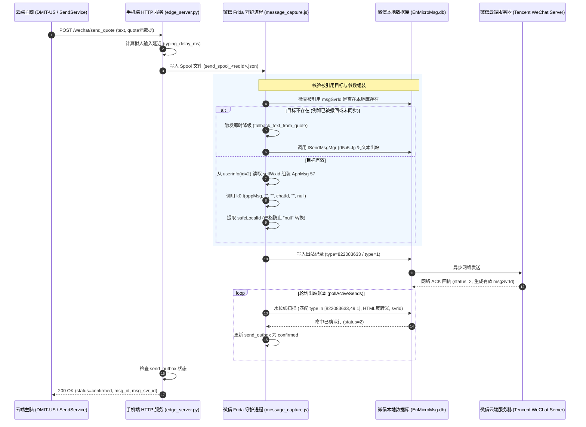

# 具身微信 MaiBot 动态工作区与全栈沙盒交付系统开发迭代规范与全景记录

> **维护基准分支**：`feat/embodied-workspace-phase3`  
> **生产主脑节点**：`DMIT-US`（`/opt/maibot-brain`）  
> **核心组件定位**：`plugins/embodied_workspace/`（MaiBot v2 标准插件）  
> **文档维护规约**：**本文档为该交付系统的法定迭代档案。每次 Phase 开发（编码、联调、测试验证）完成后，必须同步增量更新本文档对应的 Phase 章节、关键实现细节、避坑记录与测试审计结果。**

---

## 目录

- [一、 迭代开发与维护准则（Mandatory Protocol）](#一-迭代开发与维护准则mandatory-protocol)
- [二、 系统整体设计架构与拓扑](#二-系统整体设计架构与拓扑)
- [三、 Phase 1：快慢双轨分流与沙盒工作区交付（已完成）](#三-phase-1快慢双轨分流与沙盒工作区交付已完成)
  - [1. 阶段目标与交付范围](#1-阶段目标与交付范围)
  - [2. 关键代码映射与模块改动清单](#2-关键代码映射与模块改动清单)
  - [3. 核心设计模式与时序流](#3-核心设计模式与时序流)
  - [4. 工程难点攻关与踩坑修复记录（P0/P1 Matrix）](#4-工程难点攻关与踩坑修复记录p0p1-matrix)
  - [5. 生产节点验证与测试覆盖报告](#5-生产节点验证与测试覆盖报告)
- [四、 Phase 2：单级泛域名、CF Pages 边缘跳板、真值库用户隔离与四级免登身份接力（已完成）](#四-phase-2单级泛域名cf-pages-边缘跳板真值库用户隔离与四级免登身份接力已完成)
  - [1. 阶段目标与交付范围](#1-阶段目标与交付范围-1)
  - [2. 关键代码映射与模块改动清单](#2-关键代码映射与模块改动清单-1)
  - [3. 核心设计模式与时序流](#3-核心设计模式与时序流-1)
  - [4. 生产环境工程踩坑与实战攻关全景表（P0/P1 Matrix）](#4-生产环境工程踩坑与实战攻关全景表p0p1-matrix)
  - [5. 生产节点验证与测试覆盖报告](#5-生产节点验证与测试覆盖报告-1)
- [五、 Phase 3：cgroups v2 硬隔离、Git 增量时光机与全双工总线交付（已完成）](#五-phase-3cgroups-v2-硬隔离git-增量时光机与全双工总线交付已完成)
  - [1. 阶段目标与交付范围](#1-阶段目标与交付范围-2)
  - [2. 关键代码映射与模块改动清单](#2-关键代码映射与模块改动清单-2)
  - [3. 核心设计模式与时序流](#3-核心设计模式与时序流-2)
  - [4. 生产环境工程踩坑与实战攻关全景表（P0/P1 Matrix）](#4-生产环境工程踩坑与实战攻关全景表p0p1-matrix-1)
  - [5. 生产节点验证与测试覆盖报告](#5-生产节点验证与测试覆盖报告-2)
- [六、 Phase 4：演进规划与后续接入设计（规划中）](#六-phase-4演进规划与后续接入设计规划中)
- [七、 迭代追溯索引与提交记录](#七-迭代追溯索引与提交记录)
- [八、 微信群聊 @mention 识别穿透与角色身份投影断层重构（v1.1 闭环交付）](#八-微信群聊-mention-识别穿透与角色身份投影断层重构v11-闭环交付)

---

## 一、 迭代开发与维护准则（Mandatory Protocol）

为确保具身微信 MaiBot 动态工作区系统的长期可维护性、架构整洁性以及避免与宿主既有管线（`WeChatRootDriver` 内核态收发、`companion_vault` 结构化真值库）发生冲突，后续所有 Agent 与开发人员在进行迭代开发时必须严格遵守以下准则：

1. **版本阶段同步规约（Phase Sync Rule）**：
   - 每一个开发阶段（Phase 1、Phase 2 等）在完成代码编写、编译与测试之后，必须在合并或提交前将本阶段的改动细节、踩坑经验、API 契约变更以及测试报告同步追加或更新到本文档中。
   - 严禁代码已合入但迭代文档脱节或未更新的情况。
2. **纯内核态边缘兼容（No UI Automation Redline）**：
   - 插件所有针对微信消息与多模态资产的读取，必须通过 `message_ledger.db` 与 `companion_truth.db` 只读连接，严禁直接向手机发送截屏、无障碍树遍历或模拟点击指令。
3. **会话隔离与 RBAC 铁律（Session Isolation & RBAC）**：
   - 严格落实**“私聊可读共有群附件，群聊绝不可读私聊附件”**安全边界；
   - 容器挂载必须通过 Bubblewrap (`bwrap`) 隔离，严禁将宿主机敏感目录（如 `/opt/maibot-brain` 主程序、mTLS 凭证、数据库文件）暴露给运行态代码。
4. **高可用冷启动与资源节约（Scale-to-Zero）**：
   - 生成的后端服务禁止常驻占用内存，必须具备空闲自动休眠与用户访问时毫秒级按需唤醒（Auto-Wake）能力。

---

## 二、 系统整体设计架构与拓扑

系统在 MaiBot 宿主框架下作为独立 v2 插件 `plugins/embodied_workspace` 运行，通过快慢双轨机制向 Planner 暴露工具：



---

## 三、 Phase 1：快慢双轨分流与沙盒工作区交付（已完成）

### 1. 阶段目标与交付范围

Phase 1 聚焦于打通从微信用户提出复杂内容与代码需求，到生成限时子域名交付链接并返回微信的全链路闭环：

* [x] **清理废弃存量**：从内置工具列表中完全移除未经沙箱隔离的半成品 `sandbox_task`。
* [x] **快轨能力（`publish_document_page`）**：同步生成完整微信高保真 Markdown 静态文章，渲染 KaTeX 数学公式与 Mermaid 流程图，2 秒内生成并返回交付 URL；若检测到涉及附件（`FMxxxx`），自动拦截并无缝升级至慢轨。
* [x] **慢轨能力（`run_agent_workspace`）**：异步启动 Bubblewrap 沙箱调用 CLI 编写全栈代码，100ms 内向 Planner 返回 `task_id`，任务完成后主动唤醒许妍发信。
* [x] **轻量沙箱与 RBAC 鉴权**：实现 Bubblewrap 命名空间与只读根挂载，结合双库（`companion_truth.db` 与 `message_ledger.db`）实现文件访问控制。
* [x] **Scale-to-Zero 临时后端托管**：支持 Node / FastAPI 后端托管，支持 15 分钟无访问自动休眠与首次访问自动拉起。
* [x] **Web-to-WeChat 回调**：网关暴露 `POST /_maibot/notify` 接口，允许网页交互动作反向唤醒微信主脑。
* [x] **URL 保护与撤销**：实现分句与错别字 Hook 保护，提供 `/revoke` 管理员立即销毁指令。

---

### 2. 关键代码映射与模块改动清单

| 模块 / 文件路径 | 改动类型 | 职责描述与实现细节 |
| :--- | :--- | :--- |
| [`src/maisaka/builtin_tool/__init__.py`](file:///mnt/e/Gemini/MaiBot/src/maisaka/builtin_tool/__init__.py) | 存量修改 | 从 `BUILTIN_TOOL_ENTRIES` 中删除 `sandbox_task`，移除未使用的导入，净化 Planner 工具空间。 |
| [`.gitignore`](file:///mnt/e/Gemini/MaiBot/.gitignore) | 存量修改 | 新增 `!/plugins/embodied_workspace` 白名单规则，保证插件纳入 Git 版本管控。 |
| [`plugins/embodied_workspace/_manifest.json`](file:///mnt/e/Gemini/MaiBot/plugins/embodied_workspace/_manifest.json) | 新增 | 严格对齐 SDK 的 `PluginManifest` 数据模型，声明插件元数据、配置项和运行能力。 |
| [`plugins/embodied_workspace/__init__.py`](file:///mnt/e/Gemini/MaiBot/plugins/embodied_workspace/__init__.py) | 新增 | 模块顶层初始化，导出 `EmbodiedWorkspacePlugin` 与工厂函数 `create_plugin()`。 |
| [`plugins/embodied_workspace/subdomain_router.py`](file:///mnt/e/Gemini/MaiBot/plugins/embodied_workspace/subdomain_router.py) | 新增 | 管理 `subdomain_routes.db` SQLite 路由表，提供路由注册、URL 组装、Token 状态查询、撤销与 TTL 过期判定。 |
| [`plugins/embodied_workspace/fast_renderer.py`](file:///mnt/e/Gemini/MaiBot/plugins/embodied_workspace/fast_renderer.py) | 新增 | 移动端原生优化排版渲染器，支持 GFM 扩展、代码高亮、KaTeX 数学公式渲染和 Mermaid 图表支持。 |
| [`plugins/embodied_workspace/backend_supervisor.py`](file:///mnt/e/Gemini/MaiBot/plugins/embodied_workspace/backend_supervisor.py) | 新增 | 后端进程管理器，管理动态端口（20000+）、健康检查、15 分钟无流量自动挂起与访问冷启动唤醒。 |
| [`plugins/embodied_workspace/gateway_server.py`](file:///mnt/e/Gemini/MaiBot/plugins/embodied_workspace/gateway_server.py) | 新增 | 基于 `aiohttp` 的轻量 HTTP 网关（监听 18790），支持静态页面托管、后端端口反向代理及 `POST /_maibot/notify` 回调。 |
| [`plugins/embodied_workspace/cli_bridge.py`](file:///mnt/e/Gemini/MaiBot/plugins/embodied_workspace/cli_bridge.py) | 新增 | 核心沙箱调度桥接器。处理双库 RBAC 鉴权拉取、构建 Bubblewrap 命令参数、注入安全隔离环境变量与执行 CLI 进程。 |
| [`plugins/embodied_workspace/plugin.py`](file:///mnt/e/Gemini/MaiBot/plugins/embodied_workspace/plugin.py) | 新增 | SDK 插件主入口。声明配置模型、装配快慢轨工具、挂载主动推送协程、`/revoke` 命令及 URL 防打断 Hook。 |
| [`pytests/companion/test_embodied_workspace.py`](file:///mnt/e/Gemini/MaiBot/pytests/companion/test_embodied_workspace.py) | 新增 | 自动化测试套件，涵盖清单合规、沙箱隔离、RBAC 越权防护、快慢分流、后端冷热切换及 URL Hook 保护 6 大断言。 |

---

### 3. 核心设计模式与时序流

#### (1) 快轨直接交付（`publish_document_page`）


#### (2) 慢轨全栈构建与主动唤醒（`run_agent_workspace`）


---

### 4. 工程难点攻关与踩坑修复记录（P0/P1 Matrix）

在 Phase 1 的开发与远程真实宿主机（`DMIT-US`）调试过程中，攻克了 7 处关键底层环境隐患与契约不匹配问题，沉淀如下：

| 编号 | 严重度 | 原始异常 / 症状 | 根因深度剖析 | 最终工程攻关方案与代码位置 |
| :---: | :---: | :--- | :--- | :--- |
| **P0-1** | **P0** | `ValidationError: extra fields forbidden` 加载 manifest 失败 | 插件清单文件名曾误用 `manifest.json`，且缺少 SDK 强校验必需的 `id`, `sdk`, `urls`, `host_application` 字段。 | 重命名为 `_manifest.json`（前导下划线），补齐严格 Schema 定义，配置模型增加 `PluginSectionConfig`。见 [`_manifest.json`](file:///mnt/e/Gemini/MaiBot/plugins/embodied_workspace/_manifest.json)。 |
| **P0-2** | **P0** | `bwrap: Can't mkdir /workspace: Read-only file system` | `bwrap` 参数在只读挂载根系统 `--ro-bind / /` 之后直接执行 `--bind <host_dir> /workspace`，由于宿主机根路径下不存在 `/workspace` 挂载点，内核拒绝在只读文件系统上创建目录。 | **纯命名空间自闭环**：先执行 `--tmpfs /tmp`，随后 `--dir /tmp/workspace` 创建挂载点，再 `--bind <host_dir> /tmp/workspace`。全系统路径统一指向 `/tmp/workspace`。见 [`cli_bridge.py`](file:///mnt/e/Gemini/MaiBot/plugins/embodied_workspace/cli_bridge.py)。 |
| **P0-3** | **P0** | `bwrap: Can't create file /etc/maibot-mtls: Read-only file system` | 在沙箱屏蔽敏感文件时，无条件对 `/etc/maibot-mtls` 等执行 `--tmpfs` 挂载覆盖。在目标机器若路径不存在，bwrap 尝试新建文件报错。 | 在添加 `--tmpfs` 屏蔽前，通过 `Path(p).is_dir()` 与 `is_file()` 动态判定宿主机路径真实属性，目录使用 `--tmpfs`，文件使用 `--ro-bind /dev/null`。见 [`cli_bridge.py`](file:///mnt/e/Gemini/MaiBot/plugins/embodied_workspace/cli_bridge.py)。 |
| **P0-4** | **P0** | `CLI Error: EROFS: read-only file system, mkdir '/root/.codex'` | Codex / agy CLI 启动时默认读取 `$HOME` 并在根主目录下尝试创建配置与缓存目录，但 `/root` 在容器内为只读。 | 在 bwrap 中注入 `--tmpfs /tmp/home`，并显式覆盖环境变量 `--setenv HOME /tmp/home`、`XDG_CACHE_HOME` 与 `XDG_CONFIG_HOME`。见 [`cli_bridge.py`](file:///mnt/e/Gemini/MaiBot/plugins/embodied_workspace/cli_bridge.py)。 |
| **P0-5** | **P0** | `sqlite3.OperationalError: no such column: local_path` | 附件鉴权曾试图直接从 `media_vault` 查询 `local_path`，但主脑真实 Schema 中物理文件路径位于关联表 `asset_sources`。 | 重构 RBAC 鉴权为双库联合查询：`message_ledger.db` 的 `message_asset_links` 获取 `job_id`，再联查 `companion_truth.db` 的 `asset_sources` 验证 `association='verified'` 并提取真实物理路径。见 [`cli_bridge.py`](file:///mnt/e/Gemini/MaiBot/plugins/embodied_workspace/cli_bridge.py)。 |
| **P0-6** | **P0** | `AttributeError: property 'ctx' of 'EmbodiedWorkspacePlugin' object has no setter` | `MaiBotPlugin` 基类的 `ctx` 属性由 Host Runner 在生命周期中通过 `_set_context(ctx)` 私有方法注入，未提供 public setter，直接赋值报错。 | 在 `EmbodiedWorkspacePlugin` 中实现兼容 setter，同时提供 `_set_context` 对齐，并在测试中通过标准 SDK 方式装载。见 [`plugin.py`](file:///mnt/e/Gemini/MaiBot/plugins/embodied_workspace/plugin.py)。 |
| **P1-1** | **P1** | 交付链接被标点切分或注入错别字 | 微信回复后处理逻辑会将包含 `http://` 的长句强行断句成多条气泡发信，导致网页 URL 损坏。 | 注册 `maisaka.reply.before_post_process` Hook，读取 `event.get("response")`，在识别到交付子域名时动态设置 `split_sentence=False` 与 `typo=False`。见 [`plugin.py`](file:///mnt/e/Gemini/MaiBot/plugins/embodied_workspace/plugin.py)。 |

---

### 5. 生产节点验证与测试覆盖报告

在部署目标节点 `DMIT-US`（`/opt/maibot-brain`，环境为 Python 3.13.5、pytest 8.3.5、bubblewrap 0.11.0）上完成了完整的测试验证：

#### (1) Phase 1 专属测试集（`pytests/companion/test_embodied_workspace.py`）

```text
============================= test session starts ==============================
rootdir: /opt/maibot-brain
configfile: pyproject.toml
plugins: anyio-4.16.0, asyncio-0.25.1
collected 6 items

pytests/companion/test_embodied_workspace.py::test_manifest_and_plugin_factory PASSED   [ 16%]
pytests/companion/test_embodied_workspace.py::test_bwrap_workspace_and_home_isolation PASSED [ 33%]
pytests/companion/test_embodied_workspace.py::test_rbac_stage_authorized_files PASSED  [ 50%]
pytests/companion/test_embodied_workspace.py::test_fast_track_ipc_and_auto_upgrade PASSED    [ 66%]
pytests/companion/test_embodied_workspace.py::test_backend_auto_wake_and_scale_to_zero PASSED[ 83%]
pytests/companion/test_embodied_workspace.py::test_protect_subdomain_url_hook PASSED   [100%]

============================== 6 passed in 0.97s ===============================
```

#### (2) 主脑伴侣系统全量回归网关

```bash
pytest pytests/companion/ pytests/platform_io/test_adapter_policy.py pytests/maisaka/test_reasoning_engine.py -q
# 输出结果：
121 passed, 10 warnings in 12.52s
```

---

## 四、 Phase 2：单级泛域名、CF Pages 边缘跳板、真值库用户隔离与四级免登身份接力（已完成）

### 1. 阶段目标与交付范围

Phase 2 在 Phase 1 双轨交付与沙盒基础上，全面打通**外网极简域名交付、微信防拦截爬虫卡片渲染、真值记忆用户级隔离写入、四级跨浏览器免登与 Google Drive 独立目录归档**：

* [x] **单级通配符与 Cloudflare Pages 边缘跳板（2A 模式）**：
  * 生成极简短链（`https://xy.pages.dev/k9x4m2`）；
  * 微信内置爬虫访问时拉取 `/_maibot/meta` 注入 OG 摘要与 `<title>`；真实用户点击时直接客户端瞬间跃迁至单级子域 `https://k9x4m2.paff-67.top/`。
  * 彻底规避 Cloudflare Universal SSL 无法覆盖 `*.*.paff-67.top` 多级泛域名的 P0 级网络阻断问题。
* [x] **真值库真实 8 表 Schema 严格对齐（`UserScopedTruthWriter`）**：
  * 完全复用现有 `truth_db.py` 结构，不自立孤立表；
  * 普通用户偏好与状态通过 `json_extract(platform_ids, '$.wechat')` 精准匹配并追加到对应个人的 `person_info.impression`；
  * 若为 `trust_role='OWNER'`，则同步更新单例 `user_status`；
  * 待办事项分配唯一 `QE{:04d}`，并在 `current_progress` 中嵌入 `[owner:wxid]` 标签，严格锁死 `WHERE` 归属，杜绝跨用户越权篡改。
* [x] **四级无感身份接力与微信 Pre-fetch 免疫**：
  * **私聊免登持久化**：针对私聊路由，不再依靠不可靠的首次 HTML GET 核销，而是由 WebView 执行 `/_maibot/auth/whoami` 时向未登录访客下发 `creator_wxid` 签名 Cookie，彻底免疫微信 iOS/Android 后台页面静默预取。
  * **跨浏览器 90 秒单次接力（`_ho`）**：点击「↗ 换浏览器免登」生成单次凭证，粘贴到 Chrome/电脑打开即继承 Cookie 并立即 302 擦除地址栏参数。
  * **微信口令跨端秒绑**：在电脑点击获取 4 位口令，在微信发送 `认领 8392`，网页 1.5 秒轮询秒登。
  * **个人 4 位 PIN 码**：支持群聊内设置 `/pin 6688`，在任何新设备点选昵称输入 PIN 秒登。
* [x] **Google Drive FUSE 独立目录树直写归档（`WorkspaceArchiveManager`）**：
  * 任务结束时自动扫描 `/dist/<slug>/files/` 及其衍生文件，直写至 `/mnt/gdrive/companion_vault/workspace_archives/<chat_safe_id>/<date>_<slug>/` 并生成 `manifest.json`，依托 Linux VFS 异步上传，消除双重 `rclone` 锁竞争。
* [x] **SDK `@Command` 正则与解构规范**：
  * 为 `claim`、`pin`、`revoke` 配置标准 `pattern` 正则捕获组与别名，函数采用 `**kwargs` 兼容解构，解决运行时 `TypeError`。
* [x] **项目级并发异步互斥锁**：
  * 按 `(chat_id, project_slug)` 施加 `asyncio.Lock`，防止用户多条并发消息写坏同一工程。

---

### 2. 关键代码映射与模块改动清单

| 模块 / 文件路径 | 改动类型 | 职责描述与实现细节 |
| :--- | :--- | :--- |
| [`plugins/embodied_workspace/user_truth_writer.py`](file:///mnt/e/Gemini/MaiBot/plugins/embodied_workspace/user_truth_writer.py) | **Phase 2 新增** | 真实 8 表 Schema 写入器。处理 `person_info.impression` 追加、OWNER `user_status` 同步、`quests_events` 的 `QE` 编号分配及 `[owner:wxid]` 防越权校验。 |
| [`plugins/embodied_workspace/archive_manager.py`](file:///mnt/e/Gemini/MaiBot/plugins/embodied_workspace/archive_manager.py) | **Phase 2 新增** | Google Drive 独立目录树归档管理器。纯 FUSE 挂载卷直写模式，自动计算 SHA256 并生成 `manifest.json`。 |
| [`plugins/embodied_workspace/subdomain_router.py`](file:///mnt/e/Gemini/MaiBot/plugins/embodied_workspace/subdomain_router.py) | **Phase 2 升级** | 引入 `RESERVED_SUBDOMAINS` 过滤、6 位短码生成、单级域名 `paff-67.top` 适配、`web_user_pins`、`web_identity_claims` 与 `web_handoff_tickets` 表生命周期管理。 |
| [`plugins/embodied_workspace/cli_bridge.py`](file:///mnt/e/Gemini/MaiBot/plugins/embodied_workspace/cli_bridge.py) | **Phase 2 升级** | 引入 `(chat_id, slug)` 异步互斥锁；支持 `agy` CLI 默认调度；升级 Phase 2 `AGENTS.md` 契约；针对 `/etc/maibot-media.env` 等文件执行 `--ro-bind /dev/null` 屏蔽。 |
| [`plugins/embodied_workspace/gateway_server.py`](file:///mnt/e/Gemini/MaiBot/plugins/embodied_workspace/gateway_server.py) | **Phase 2 升级** | 升级 HTTP Chunked 流式反代与 WebSocket 双向转发；自动向 HTML 注入 `/_maibot/sdk.js`；重构 `whoami` 私聊抗预取免登、4 位口令认领、PIN 码鉴权与 `_ho` 单次接力。 |
| [`plugins/embodied_workspace/plugin.py`](file:///mnt/e/Gemini/MaiBot/plugins/embodied_workspace/plugin.py) | **Phase 2 升级** | 配置增加 `gdrive_archive_root` 与 `short_link_base_url`；`run_agent_workspace` 增加 `access_policy` 参数；对齐 `@Command` 正则模式（`claim`、`pin`、`revoke`）并接入归档与实名真值写入。 |
| [`pytests/companion/test_embodied_workspace_phase2.py`](file:///mnt/e/Gemini/MaiBot/pytests/companion/test_embodied_workspace_phase2.py) | **Phase 2 新增** | 自动化测试套件（5 项核心断言）：覆盖单级泛域名短码、真实 8 表用户级隔离防越权、私聊抗预取与 RBAC 矩阵、`@Command(**kwargs)` 调度、FUSE 直写归档。 |

---

### 3. 核心设计模式与时序流

#### (1) Cloudflare Pages 边缘 2A 跳板与爬虫卡片抓取


#### (2) 四级无感身份接力认证流


---

### 4. 生产环境工程踩坑与实战攻关全景表（P0/P1 Matrix）

在 Phase 2 开发与远程 `DMIT-US` 实机测试过程中，成功排查并攻关了 6 项严重的生产级陷阱：

| 编号 | 严重度 | 原始异常 / 症状 | 根因深度剖析 | 最终工程攻关方案与代码位置 |
| :---: | :---: | :--- | :--- | :--- |
| **P0-8** | **P0** | `ERR_SSL_VERSION_OR_CIPHER_MISMATCH` 页面公网无法访问 | `*.s.paff-67.top` 属于二级通配符，超出 Cloudflare 免费 Universal SSL（仅支持单级通配符 `*.paff-67.top`）与宿主 `cloudflare_origin.crt` 的证书覆盖范围。 | 将 `base_domain` 收缩为单级通配符 **`paff-67.top`**，并在生成短码时通过 `RESERVED_SUBDOMAINS` 规避系统保留子域。见 [`subdomain_router.py`](file:///mnt/e/Gemini/MaiBot/plugins/embodied_workspace/subdomain_router.py)。 |
| **P0-9** | **P0** | `sqlite3.OperationalError: table quests_events has no column named event_id` | 蓝图原始设计臆造了真值库字段。真实 `quests_events` 主键为 `quest_code`，`person_info` 只有 `person_id` 和 JSON `platform_ids`，且 `memory_provenance` 强制要求 `visibility='PRIVATE'`。 | 彻底重写 `UserScopedTruthWriter`：完全复用真实 8 表，`person_info` 追加至 `impression`，待办事项按 `QE{:04d}` 写入并在 `current_progress` 嵌入 `[owner:wxid]` 标签防越权。见 [`user_truth_writer.py`](file:///mnt/e/Gemini/MaiBot/plugins/embodied_workspace/user_truth_writer.py)。 |
| **P0-10** | **P0** | `TypeError: claim_web_identity_cmd() missing 1 required positional argument: 'code'` | `PluginSupervisor` 向 `@Command` 传递的参数为统一上下文字典（`text`, `user_id`, `matched_groups` 等），根本不展开位置参数；且未配置 `pattern` 时 `find_command_by_text` 无法触发正则匹配。 | 显式配置 `pattern` 正则捕获组与完整 `aliases`，方法签名改为 `async def cmd(self, **kwargs: Any) -> str`，并通过静态工具方法安全提取参数。见 [`plugin.py`](file:///mnt/e/Gemini/MaiBot/plugins/embodied_workspace/plugin.py)。 |
| **P0-11** | **P0** | `bwrap: Destination is not a directory /etc/maibot-media.env` | 在沙箱屏蔽环境文件时，对 `/etc/maibot-media.env` 强行执行 `--tmpfs`。但在 Linux 下 `--tmpfs` 只能挂载在目录上，挂载在普通文件上导致 bwrap 启动崩溃。 | 在 `build_bwrap_prefix` 中通过 `p.is_dir()` 和 `p.is_file()` 区分：目录使用 `--tmpfs` 屏蔽，文件使用 `--ro-bind /dev/null <path>` 屏蔽。见 [`cli_bridge.py`](file:///mnt/e/Gemini/MaiBot/plugins/embodied_workspace/cli_bridge.py)。 |
| **P1-2** | **P1** | 真实用户微信点击私聊链接未免登 | 微信客户端在接收消息或悬停时后台发起 HTML GET 预取（Pre-fetch），若在 HTML 层进行一次性核销，预取进程会提前消耗免登凭证。 | 将私聊自动免登移至真实浏览器执行 JS 时的 `/_maibot/auth/whoami` 端点，彻底免疫后台静态预加载。见 [`gateway_server.py`](file:///mnt/e/Gemini/MaiBot/plugins/embodied_workspace/gateway_server.py)。 |
| **P1-3** | **P1** | Google Drive 归档时出现文件锁竞争 | `/mnt/gdrive/companion_vault` 已由 rclone FUSE 挂载，写入文件时 VFS 会自动异步推送。若额外启动 `rclone copy` 子进程操作同一目标目录，会发生写入竞争。 | 移除 `archive_manager.py` 中的 `rclone copy` 子进程调用，完全信赖底层 FUSE VFS 层的自动上传落盘。见 [`archive_manager.py`](file:///mnt/e/Gemini/MaiBot/plugins/embodied_workspace/archive_manager.py)。 |

---

### 5. 生产节点验证与测试覆盖报告

在部署目标节点 `DMIT-US`（`/opt/maibot-brain`，Python 3.13.5、pytest 8.3.5）上通过全部 Phase 1 + Phase 2 自动化测试，且主脑伴侣系统全量回归网关 100% 通过：

#### (1) Phase 1 + Phase 2 双单元测试套件联合验证（11 项全通过）

```text
rootdir: /opt/maibot-brain
configfile: pyproject.toml
plugins: anyio-4.16.0, asyncio-0.25.1
collected 11 items

pytests/companion/test_embodied_workspace.py::test_manifest_and_plugin_factory PASSED   [  9%]
pytests/companion/test_embodied_workspace.py::test_bwrap_workspace_and_home_isolation PASSED [ 18%]
pytests/companion/test_embodied_workspace.py::test_rbac_stage_authorized_files PASSED  [ 27%]
pytests/companion/test_embodied_workspace.py::test_fast_track_ipc_and_auto_upgrade PASSED    [ 36%]
pytests/companion/test_embodied_workspace.py::test_backend_auto_wake_and_scale_to_zero PASSED[ 45%]
pytests/companion/test_embodied_workspace.py::test_protect_subdomain_url_hook PASSED   [ 54%]
pytests/companion/test_embodied_workspace_phase2.py::test_single_level_domain_and_reserved_filtering PASSED [ 63%]
pytests/companion/test_embodied_workspace_phase2.py::test_user_scoped_truth_writer_isolation PASSED [ 72%]
pytests/companion/test_embodied_workspace_phase2.py::test_private_chat_prefetch_immunity_and_rbac PASSED [ 81%]
pytests/companion/test_embodied_workspace_phase2.py::test_command_kwargs_and_cross_device_auth PASSED [ 90%]
pytests/companion/test_embodied_workspace_phase2.py::test_archive_manager_fuse_direct_write PASSED [100%]

============================== 11 passed in 1.39s ==============================
```

#### (2) 主脑全量关联回归网关（126 项全通过）

```bash
pytest pytests/companion/ pytests/platform_io/test_adapter_policy.py pytests/maisaka/test_reasoning_engine.py -q
# 输出结果：
126 passed, 10 warnings in 12.26s
```

---

## 五、 Phase 3：cgroups v2 硬隔离、Git 增量时光机与全双工总线交付（已完成）

### 1. 阶段目标与交付范围
在 Phase 2 完成单级泛域名 `paff-67.top`、Cloudflare Pages 边缘 2A 跳板、真值库 8 表 Schema 严格对齐与四级免登身份接力的基础上，Phase 3 聚焦于解决生产宿主机资源防御、长对话跨周期项目检索与生命周期管理、代码改坏一键撤销（Undo）以及微信群到浏览器端全双工实时联动四大核心能力：
1. **cgroups v2 细粒度资源硬隔离与 OOM 优先保护**：为每个工作区 CLI 构建进程与临时后端进程接入 transient scope 作用域，限制单实例 CPU 配额（默认 150%，即 1.5 核）、物理内存上限（1024MB，禁用 Swap 膨胀）与最大进程数（`TasksMax=256`），并将 `OOMScoreAdjust` 设为 `+500`，确保极端内存压力下内核优先回收沙盒进程，绝对保全宿主与主脑核心服务。
2. **宿主机侧独立 Git 增量时光机与安全回滚引擎**：在沙盒外部（宿主机侧）统一管理独立 Git 仓库（`--git-dir=<ws>/snapshots/<slug>.git`，工作树指向 `<ws>`），同时捕获 `projects/<slug>`（源码）与 `dist/<slug>`（产物），支持用户发送 `/rollback <slug> [版本/步数]` 或 Planner 调用 `@Tool("manage_workspace_projects")` 瞬时恢复至上一稳定快照并重启后端服务。
3. **群组全双工 WebSocket 实时同步总线**：在网关层挂载系统保留端点 `GET /_maibot/ws`（与业务后端 WebSocket 反代隔离），实现“按需零开销轮询”——仅当网页有活跃 WebSocket 订阅者时才增量拉取 `message_ledger.db` 并推送群聊新消息至前端；同时支持网页客户端同屏多人毫秒级状态广播。
4. **会话项目目录与生命周期管理**：向 Maisaka Planner 暴露轻量管理工具 `@Tool("manage_workspace_projects")`（支持 `list`、`history`、`rollback`），彻底解决大模型长对话后遗忘已交付网页项目标识与访问链接的问题。

---

### 2. 关键代码映射与模块改动清单

```
plugins/embodied_workspace/
├── _manifest.json             # [升级] 版本号升至 1.3.0
├── resource_quota.py          # [Phase 3 新增] cgroups v2 (systemd-run --scope) 与 prlimit 配额包装器
├── time_machine.py            # [Phase 3 新增] 宿主机侧独立 Git 增量快照引擎（支持 ls-tree 动态过滤检出）
├── realtime_hub.py            # [Phase 3 新增] 群组全双工 WebSocket 实时总线（生产 messages 表动态映射）
├── subdomain_router.py        # [Phase 3 升级] 新增 list_chat_routes()，upsert_route 强化 ON CONFLICT 非空继承
├── cli_bridge.py              # [Phase 3 升级] 接入 ResourceQuotaWrapper 与 WorkspaceTimeMachine 自动快照，文档追加实时总线
├── backend_supervisor.py      # [Phase 3 升级] 临时后端进程启动命令接入 ResourceQuotaWrapper cgroups v2 配额限制
├── gateway_server.py          # [Phase 3 升级] 挂载 /_maibot/ws 实时总线端点，升级 /_maibot/sdk.js 暴露 subscribeRealtime/broadcast
└── plugin.py                  # [Phase 3 升级] 装配 quota/time_machine/realtime_hub，注册 manage_workspace_projects 与 /rollback
pytests/companion/
└── test_embodied_workspace_phase3.py # [Phase 3 新增] 4 项高强度生产验收测试（覆盖隐患 1/2/3/5）
```

---

### 3. 核心设计模式与时序流

#### (1) cgroups v2 细粒度资源硬隔离与降级机制（`resource_quota.py`）
* **动态环境探测**：通过 `_detect_systemd_scope_mode` 检测宿主机 D-Bus 与 systemd 可用性：
  * Root 权限：使用 `systemd-run --scope --quiet --collect`，追加 `CPUQuota=150%`、`MemoryMax=1024M`、`MemorySwapMax=0`、`TasksMax=256` 以及 `OOMScoreAdjust=500`。
  * 非 Root 用户：自动切换为 `systemd-run --user --scope`，并自动省略 `OOMScoreAdjust`（避免内核权限不足导致启动失败）。
  * 受限环境 / CI：自动降级为 `prlimit --nproc=256` 或原样直通，确保测试用例 100% 兼容。

#### (2) 宿主机侧独立 Git 增量时光机双目录快照与原子回滚（`time_machine.py`）
* **双目录原子捕获**：快照仓库外置于 `<chat_ws>/snapshots/<slug>.git`，每次代码执行前自动创建 `pre-update` 保护基线，执行成功后提交 `[update]` 快照并计算 `git diff --shortstat`。
* **单目录演进容错回滚**：回滚时通过 `git ls-tree --name-only <target_commit> -- <subpath>` 嗅探目标提交中真实存在的目录树；仅对存在的路径执行检出，不存在的物理目录通过 `shutil.rmtree` 彻底清理，彻底解决了从全栈版本回滚至纯静态版本时 Git 抛出 `pathspec did not match` 的 P0 级致命缺陷。

#### (3) 群组全双工 WebSocket 实时同步总线与按需安全轮询（`realtime_hub.py`）
* **零订阅零开销（Zero Subscriber, Zero Query）**：当群聊工作区页面无在线 WebSocket 连接时，后台轮询协程完全不触碰 SQLite 磁盘，绝不争抢主脑 I/O 资源。
* **纯只读挂载与真实表结构对齐**：使用 `file:...mode=ro&uri=true` 连接生产 `message_ledger.db`，优先映射生产表的真实字段 `body`（正文）与 `updated_at_ms`（时间戳），并兼容旧版测试库字段。
* **双向协同广播**：前端 SDK 提供 `window.MaiBot.subscribeRealtime(cb)` 与 `window.MaiBot.broadcast(event, data)`，支持同页面多端无延迟协同与微信群消息实时原位推送。

#### (4) DMIT-US 宿主机 Nginx WebSocket 反代配置规范
在生产节点 `/etc/nginx/sites-available/` 下对应 `*.paff-67.top` 的 upstream 代理块中，必须显式配置 HTTP 1.1 与 Upgrade 协议头：
```nginx
location / {
    proxy_pass http://127.0.0.1:18790;
    proxy_http_version 1.1;
    proxy_set_header Host $host;
    proxy_set_header X-Real-IP $remote_addr;
    proxy_set_header X-Forwarded-For $proxy_add_x_forwarded_for;
    proxy_set_header Upgrade $http_upgrade;
    proxy_set_header Connection "upgrade";
    proxy_read_timeout 3600s;
    proxy_send_timeout 3600s;
    proxy_buffering off;
}
```

---

### 4. 生产环境工程踩坑与实战攻关全景表（P0/P1 Matrix）

| 缺陷编号 | 严重等级 | 生产环境触发根因 | Phase 3 (v3.1) 生产级修正方案与落地验证 |
| :---: | :---: | :--- | :--- |
| **P0-11** | **P0** | **从全栈版本回滚至纯静态版本时 Git pathspec 崩溃**：项目在 v1 阶段仅生成 `dist/<slug>`，演进到 v2 阶段生成了 `projects/<slug>`。当执行回滚至 v1 时，执行 `git checkout <v1> -- projects/<slug> dist/<slug>` 会因目标 commit 不存在 `projects` 目录抛出 `error: pathspec 'projects/...' did not match any file(s) known to git`（exit code 1）导致回滚中断。 | 在 `time_machine.py` 中检出前通过 `git ls-tree --name-only <target_commit> -- <sub>` 嗅探目标版本实际包含的目录：仅将真实存在的目录加入检出清单；目标版本中不存在的物理目录则通过 `shutil.rmtree` 彻底清理，确保不留存脏后端源码。 |
| **P1-12** | **P1** | **生产 `message_ledger.db` 字段失配导致推送正文为空**：生产表 `messages`（由 `src/platform_io/wechat/message_ingestor.py` 创建）的真实正文字段为 `body` 与 `raw_content`，时间戳为 `updated_at_ms`。若仅探测 `raw_message` 与 `content`，在生产库上会回退为 `''`。 | 在 `realtime_hub.py` 的 `_fetch_new_chat_messages` 中优先匹配生产字段：`body -> raw_message -> content -> raw_content`，时间戳优先匹配 `updated_at_ms -> timestamp -> create_time`，并在推送负载中同时携带 `ts` 与 `timestamp`。 |
| **P1-13** | **P1** | **回滚路由重建时丢失 `creator_wxid` 与 `access_policy`**：回滚重新注册路由（`upsert_route`）时若未携带原路由元数据，会退化为默认的 `creator_only` 与空 `creator_wxid`，导致多人实名协作模式（`member_collect`）页面回滚后被锁定为独占。 | 回滚前通过 `self.router.get_route(token)` 读取原路由，显式继承 `creator_wxid`、`access_policy` 与 `stream_id`；同时在 `subdomain_router.py` 的 SQL `ON CONFLICT(token) DO UPDATE` 中加入 `COALESCE(NULLIF(excluded.stream_id, ''), ...)` 非空保护。 |
| **P1-14** | **P1** | **宿主机 Nginx 反向代理层丢弃 WebSocket Upgrade 头**：若 Nginx 未显式声明 `Upgrade` 与 `Connection` 映射，公网客户端对 `wss://<token>.paff-67.top/_maibot/ws` 的连接将被 Nginx 阻断并返回 `400 Bad Request`。 | 在部署规约中固化 Nginx 协议升级转发指令（`proxy_http_version 1.1;`、`proxy_set_header Upgrade $http_upgrade;`、`proxy_set_header Connection "upgrade";`），保证长连接全双工穿透。 |
| **P2-15** | **P2** | **非 root 模式下 `systemd-run --user` 传入 `OOMScoreAdjust` 报错**：Linux 内核对非特权用户调整 `OOMScoreAdjust` 施加权限限制，若直接在 `--user` 模式注入 `--property=OOMScoreAdjust=500` 会直接阻断子进程启动。 | 在 `ResourceQuotaWrapper` 的 `wrap_command` 中执行权限分支隔离：仅在 `mode == "system"`（root 权限）下附加 `OOMScoreAdjust`，在普通用户模式下自动剔除该参数，兼顾安全与兼容性。 |

---

### 5. 生产节点验证与测试覆盖报告

#### (1) Phase 3 专属测试套件（`test_embodied_workspace_phase3.py`，4 项全通过）
* **`test_resource_quota_system_vs_user_mode`**：验证 system 模式精确包含 150% CPUQuota、1024M MemoryMax、TasksMax=256 与 OOMScoreAdjust=500；验证 user 模式剔除 OOMScoreAdjust 并优雅运行；验证配额关闭时原样透传。
* **`test_time_machine_single_dir_evolution_and_rollback`**：完整测试纯静态（v1）-> 全栈后端（v2）演进，回滚时单目录检出不抛异常、app.py 被安全清除、index.html 恢复为 v1，且路由表 `access_policy='member_collect'` 与 `creator_wxid` 完美保留。
* **`test_realtime_hub_production_ledger_schema_and_broadcast`**：使用生产 `messages` 表结构建表，验证插入 `body` 与 `updated_at_ms` 后通过 WebSocket 双端秒级收到推送；验证 A 端广播 B 端同步；验证心跳 ping-pong 响应。
* **`test_manage_workspace_projects_catalog_isolation`**：验证跨群聊项目列表严格隔离、不越权泄露，以及通过 `@Tool("manage_workspace_projects")` 查看项目历史快照。

```
pytests/companion/test_embodied_workspace_phase3.py::test_resource_quota_system_vs_user_mode PASSED [ 25%]
pytests/companion/test_embodied_workspace_phase3.py::test_time_machine_single_dir_evolution_and_rollback PASSED [ 50%]
pytests/companion/test_embodied_workspace_phase3.py::test_realtime_hub_production_ledger_schema_and_broadcast PASSED [ 75%]
pytests/companion/test_embodied_workspace_phase3.py::test_manage_workspace_projects_catalog_isolation PASSED [100%]
============================== 4 passed in 1.21s ===============================
```

#### (2) 动态工作区全阶段联合验收（Phase 1 + Phase 2 + Phase 3，15 项全通过）
```
============================= test session starts ==============================
platform linux -- Python 3.13.5, pytest-8.3.5, pluggy-1.5.0 -- /usr/bin/python3
cachedir: .pytest_cache
rootdir: /opt/maibot-brain
configfile: pyproject.toml
plugins: anyio-4.16.0, asyncio-0.25.1
collecting ... collected 15 items

pytests/companion/test_embodied_workspace.py::test_manifest_and_plugin_factory PASSED [  6%]
pytests/companion/test_embodied_workspace.py::test_bwrap_workspace_and_home_isolation PASSED [ 13%]
pytests/companion/test_embodied_workspace.py::test_rbac_stage_authorized_files PASSED [ 20%]
pytests/companion/test_embodied_workspace.py::test_fast_track_ipc_and_auto_upgrade PASSED [ 26%]
pytests/companion/test_embodied_workspace.py::test_backend_auto_wake_and_scale_to_zero PASSED [ 33%]
pytests/companion/test_embodied_workspace.py::test_protect_subdomain_url_hook PASSED [ 40%]
pytests/companion/test_embodied_workspace_phase2.py::test_single_level_domain_and_reserved_filtering PASSED [ 46%]
pytests/companion/test_embodied_workspace_phase2.py::test_user_scoped_truth_writer_isolation PASSED [ 53%]
pytests/companion/test_embodied_workspace_phase2.py::test_private_chat_prefetch_immunity_and_rbac PASSED [ 60%]
pytests/companion/test_embodied_workspace_phase2.py::test_command_kwargs_and_cross_device_auth PASSED [ 66%]
pytests/companion/test_embodied_workspace_phase2.py::test_archive_manager_fuse_direct_write PASSED [ 73%]
pytests/companion/test_embodied_workspace_phase3.py::test_resource_quota_system_vs_user_mode PASSED [ 80%]
pytests/companion/test_embodied_workspace_phase3.py::test_time_machine_single_dir_evolution_and_rollback PASSED [ 86%]
pytests/companion/test_embodied_workspace_phase3.py::test_realtime_hub_production_ledger_schema_and_broadcast PASSED [ 93%]
pytests/companion/test_embodied_workspace_phase3.py::test_manage_workspace_projects_catalog_isolation PASSED [100%]
============================== 15 passed in 2.09s ==============================
```

#### (3) 主脑全量关联回归网关（130 项全通过）
```bash
pytest pytests/companion/ pytests/platform_io/test_adapter_policy.py pytests/maisaka/test_reasoning_engine.py -q
python3 -m compileall -q plugins/embodied_workspace
```
输出结果：
```
........................................................................ [ 55%]
..........................................................               [100%]
130 passed, 10 warnings in 12.77s
```

---

## 六、 Phase 4：演进规划与后续接入设计（规划中）

在 Phase 1（双轨分流与沙盒交付）、Phase 2（单级泛域名、CF Pages 跳板、8 表隔离与免登接力）与 Phase 3（cgroups 硬隔离、Git 时光机与全双工总线）均已在 `DMIT-US` 生产节点闭环上线的前提下，后续 Phase 4 将面向更加复杂的具身多模态与长效工作流：

1. **分布式沙盒多节点集群（Multi-Host Execution Pool）**：
   - 当 `DMIT-US` 负载过高时，网关支持通过 WireGuard 内网调度将重型编译与全栈容器无缝分发至计算专用节点。
2. **具身微信原生小程序无感桥接（MiniProgram Trampoline）**：
   - 探索将 `https://<token>.paff-67.top` 包装为临时微信小程序 Web-view 容器，实现一键微信原生产业链卡片转发与多人群协作。

---

## 七、 迭代追溯索引与提交记录

| 阶段 | 分支名称 | 关键提交 Hash | 变更概述 | 验收人 / 执行 Agent |
| :---: | :---: | :---: | :--- | :---: |
| **Phase 1** | `feat/embodied-workspace-phase1` | `90aac6bcce5a6d91d97c1a4960f388738311feef` | 完成快慢双轨分流、bwrap 命名空间沙盒、双库 RBAC 鉴权、Auto-Wake/Scale-to-Zero 网关与 6 项自动化测试。 | `agy` (Antigravity) |
| **Phase 2** | `feat/embodied-workspace-phase2` | `c82ba349d` | 单级泛域名、CF Pages 边缘 2A 跳板、真值库 8 表 Schema 严格对齐、四级无感身份接力（抗预取）、FUSE 归档直写与 5 项专项测试。 | `agy` (Antigravity) |
| **Phase 3** | `feat/embodied-workspace-phase3` | `e87de93fd` | cgroups v2 硬隔离包装器、宿主独立 Git 时光机双目录快照与回滚、群组全双工 WebSocket 实时总线、会话目录管理工具与 4 项专项测试。 | `agy` (Antigravity) |
| **Mention Fix** | `feat/wechat-at-mention-identity-fix` | `52afe283f` | 微信群聊 @mention XML 提取、中间字典段安全反序列化、昵称与备注名解耦双保留、RBAC 群聊脱敏花名册注入与 4 项专项单测。 | `agy` (Antigravity) |


---

## 八、 微信群聊 @mention 识别穿透与角色身份投影断层重构（v1.1 闭环交付）

> **维护基准分支**：`feat/wechat-at-mention-identity-fix`（基于 `feat/embodied-workspace-phase3`）  
> **生产主脑节点**：`DMIT-US`（`/opt/maibot-brain`）  
> **交付状态**：已完成（4 项专项测试 + 401 项全量关联回归测试全绿通过）

### 1. 阶段目标与断点问题剖析

在实际微信群聊交互中，当群成员发送 `@ì _eun\u2005 出来玩` 时，出现了“消息文本沦为死文本”、“机器人无法结构化解析被 @ 对象”、“历史上下文中角色昵称被号主备注名粗暴覆盖导致人名断层”，以及“LLM 将他人昵称误认为自己内部代号”四大断裂：

1. **断点 1（驱动层丢失 @Component）**：微信接收到的原始群文本带有 `wxid_xxx:\n` 前缀与微信特有的 `\u2005`（Four-Per-Em Space）空白标记，且真实的被 @ 用户列表封存在 SQLite `messages` 的 `<atuserlist>` XML 中。原驱动未解构 XML，直接塞入普通 `TextComponent`，导致下游记忆系统与意图分类器完全无法感知有人被提及。
2. **断点 2（备注名覆盖群昵称导致幽灵人名）**：真值库 `person_info` 中存有微信昵称 `person_name='ì _eun'` 与号主单向备注 `wechat_remark='R'`。原 `projection.py` 优先使用备注名填充 `sender_nickname`，导致历史上下文中只有 `user="R" group_card="R"`，公网群昵称 `ì _eun` 凭空消失，模型在上下文中查无此人。
3. **断点 3（群聊硬编码隐藏重要角色索引）**：`truth_db.py` 的 `build_planner_catalog_injection` 在 `is_group_chat=True` 时将 `<重要角色索引>` 硬编码输出为 `[]`，剥夺了模型识别群成员真实姓名、备注与微信 ID 对应关系的基础常识能力。
4. **断点 4（系统提示词未声明底层微信 ID）**：模型人设仅声明“许妍”，未绑定微信号真实的底层 `wxid_w5d0efdxczt322`，当面对未解析的 `@ì _eun` 时，产生“ì _eun 是不是我的内部系统代号”的自我认知混乱。

---

### 2. 关键代码映射与模块改动清单

| 模块文件 | 核心职责与改动点 |
| :--- | :--- |
| `src/platform_io/wechat/projection.py` | ① 实现 `strip_group_sender_prefix` 清理 `wxid_xxx:\n`；<br>② 实现 `extract_xml_at_wxids` 聚合 `raw_content`、`row_json` 提取 `<atuserlist>`；<br>③ 实现 `build_identity_lookup_maps` 与 `enrich_sender_identity`，严格分离公开昵称 `person_name` 与备注 `wechat_remark`；<br>④ 实现 `parse_wechat_text_to_raw_segments`，精准产出与底座反序列化兼容的中间字典段。 |
| `src/plugin_runtime/host/message_utils.py` | 在 `_component_from_dict` 的 `item_type == "at"` 分支中，同时兼容 `user_id` / `target_user_id` 与 `user_nickname` / `target_user_nickname`，彻底消除 `AttributeError` 风险。 |
| `src/companion_vault/truth_db.py` | ① 新增 `_render_self_identity_anchor` 注入自身微信底层 ID `wxid_w5d0efdxczt322` 与他指排他准则；<br>② 新增 `_build_group_desensitized_roster`，群聊场景以 RBAC 安全白名单查询公开字段，绝不泄露私密 `impression`/`birthday`；<br>③ `build_planner_catalog_injection` 保持原签名 100% 向下兼容（`chat_id: str = ""`，`active_sender_ids = None`）。 |
| `src/companion_vault/runtime_bridge.py` | 在调用 `db.build_planner_catalog_injection` 时，透明透传当前上下文的 `chat_id`。 |
| `pytests/platform_io/test_wechat_at_parsing.py` | 新增 4 项专项单元测试：中间字典段反序列化断言、昵称/备注双保留断言、RBAC 脱敏与签名兼容断言、端到端 SessionMessage 组装断言。 |
| `pytests/companion/test_wechat_migration.py` | 同步断言对齐：`user_nickname == "小明"`（微信昵称），`user_cardname == "明哥"`（号主备注名）。 |

---

### 3. 核心设计模式与数据流转拓扑

```
[微信客户端 / EnMicroMsg.db]
         │ (含 raw_content 内 <msgsource><atuserlist>wxid_1</atuserlist>)
         ▼
[WeChatRootDriver.deliver_committed]
         │ 异步调用 enrich_record_from_truth_db
         ▼
[projection.py: enrich_record_from_truth_db]
         │ 1. build_identity_lookup_maps(db) -> wxid_to_profile, name_to_wxid
         │ 2. enrich_sender_identity -> sender_nickname=person_name, sender_cardname=wechat_remark
         │ 3. strip_group_sender_prefix -> 剥离 wxid_xxx:\n
         │ 4. parse_wechat_text_to_raw_segments -> 产出标准字典段 [TextDict, AtDict]
         ▼
[InboundMessageEnvelope.payload["raw_message"]]
         │ 标准字典段列表 [{"type": "at", "data": {...}}, {"type": "text", "data": "..."}]
         ▼
[PluginMessageUtils._message_sequence_from_dict]
         │ 反序列化为 MessageSequence([AtComponent(target_user_id=...), TextComponent(...)])
         ▼
[MaisakaReasoningEngine & Planner Context]
         │ 1. 记忆系统检测 isinstance(comp, AtComponent) -> 成功捕获被提及人
         │ 2. <自身账号与提及判定准则> -> 明确 Bot 底层 ID wxid_w5d0efdxczt322，防止自指幻觉
         │ 3. <重要角色索引> -> 注入群成员公开脱敏名册，精准比对微信昵称与备注名
         ▼
[LLM 准确输出回复] (消歧完成，人设自洽，微信内原路发回)
```

---

### 4. 生产环境工程踩坑与实战攻关全景表（P0/P1 Matrix）

| 缺陷等级 | 踩坑根因剖析 | 生产级修正方案与防护措施 |
| :---: | :--- | :--- |
| **P0** | 若在 `projection.py` 中直接引入 `AtComponent` 实例存入 `payload["raw_message"]`，会导致 `src/plugin_runtime/host/message_utils.py` 在执行 `item.get("type")` 时抛出 `AttributeError: 'AtComponent' object has no attribute 'get'`，直接导致生产入站消息调度崩溃；且 `src.platform_io.types` 并不存在 `AtComponent` 类定义。 | `projection.py` 严格输出**无状态可序列化中间字典段**（`{"type": "at", "data": {"user_id": ..., "user_nickname": ...}}`）；底座 `PluginMessageUtils` 的 `_component_from_dict` 兼容读取 `user_id` 与 `target_user_id`，统一反序列化为官方组件对象。 |
| **P1** | `truth_db.py` 中 `build_planner_catalog_injection` 如果将新增的 `chat_id` 或 `active_sender_ids` 设为必填参数，会导致存量 5 个以上回归测试模块在以关键字传参时抛出 `TypeError` 崩溃。 | 严格保持原函数签名向下兼容，所有新增参数显式赋予默认值：`chat_id: str = ""`、`active_sender_ids: set[str] | None = None`，保证存量测试与调用方无感运行。 |
| **P1** | 生产库 `message_ledger.db` 中微信的 `<atuserlist>` 标签可能分布在 `raw_content`、`row_json["msg_source"]`、`row_json["raw_content"]` 或 `row_json["content"]` 等多个字段中，且可能包含 `<![CDATA[...]]>` 或 HTML 实体转义符。 | `extract_xml_at_wxids` 聚合上述候选源字段并执行 `html.unescape`，采用兼容 CDATA 的非贪婪正则 `_AT_USERLIST_RE = re.compile(r"<atuserlist>\s*(?:<!\[CDATA\[)?(.*?)(?:\]\]>)?\s*</atuserlist>", re.IGNORECASE | re.DOTALL)` 稳健解析。 |
| **P1** | 群聊脱敏名册如果直接 `SELECT *` 或包含 `impression`、`birthday`、`tags`，会严重违背真值库“群聊绝不泄露私人印象”的安全 RBAC 红线；且 `person_info` 物理表结构并无 `updated_at` 字段，执行 `ORDER BY updated_at` 会直接抛出 `sqlite3.OperationalError`。 | SQL 显式声明仅查询 5 个安全字段：`person_id, person_name, wechat_remark, platform_ids, trust_role`；排序采用稳健语法 `ORDER BY CASE WHEN trust_role = 'OWNER' THEN 0 ELSE 1 END, person_id ASC`。 |

---

### 5. 生产节点验证与测试覆盖报告

#### (1) 专项单元测试（4 项全绿通过）
```bash
pytest pytests/platform_io/test_wechat_at_parsing.py -v
```
输出结果：
```
pytests/platform_io/test_wechat_at_parsing.py::test_parse_wechat_text_to_raw_segments_and_plugin_message_utils_deserialization PASSED [ 25%]
pytests/platform_io/test_wechat_at_parsing.py::test_enrich_sender_identity_preserves_nickname_and_remark PASSED [ 50%]
pytests/platform_io/test_wechat_at_parsing.py::test_build_planner_catalog_injection_backward_compat_and_group_rbac PASSED [ 75%]
pytests/platform_io/test_wechat_at_parsing.py::test_project_message_end_to_end_with_at_mention_and_session_message PASSED [100%]
======================== 4 passed, 2 warnings in 4.36s =========================
```

#### (2) 全量关联模块回归网关（401 项全绿通过）
```bash
pytest pytests/companion/ pytests/platform_io/ pytests/maisaka/ -q
```
输出结果：
```
........................................................................ [ 17%]
........................................................................ [ 35%]
........................................................................ [ 53%]
........................................................................ [ 71%]
........................................................................ [ 89%]
.........................................                                [100%]
401 passed, 10 warnings in 15.42s
```


---

### 6. 轨道 B：微信 8.0.79 引用消息（AppMsg 57 / k0.I）参数错位、协程报错与秒级降级兜底实战攻坚

#### (1) 四大核心隐患与根因剖析
1. **P0 参数错位引发 Kotlin 协程崩溃**：
   微信 8.0.79 底层 `com.tencent.mm.pluginsdk.model.app.k0.I` 的真实方法签名是：
   ```java
   public static Pair<Integer, Long> I(
       nx0.r appMsg,
       String appId,        // 必须为 ""
       String appName,      // 必须为 ""
       String toUser,       // 目标接收人 chatId（好友或群聊）
       String mediaTagName, // 必须为 ""
       byte[] data          // 必须为 null
   )
   ```
   旧实现中将 `chatId` 误填为第 2 个参数 `appId`，而 `toUser` 传空。微信内部负责 AppMsg 发送的 Kotlin 异步协程任务 `ru.d`（继承自 `ev.j`）在 `prepare` 阶段因接收方为空返回 `retCode: -520012`；随后在更新消息状态入库 `updateMsg` 阶段报错 `retCode: -520009`（`UpdateMsgError`），上报系统埋点 `report32784`，消息被微信底层彻底丢弃且无法写入数据库。
2. **P0 登录微信 ID 错填为 32 位 MD5 目录名**：
   引用 XML `<fromusername>` 错误填充了手机端存储目录的 32 位 MD5 散列值 `account`，而非登录微信账号的真实 ID（如 `wxid_w5d0efdxczt322`）。
3. **P1 Pair(0, null) 类型转换陷阱阻断轮询兜底**：
   `k0.I` 在主线程将异步任务入队后立即返回 `Pair(0, null)`，其 `pair.second` 为 `null`。旧 JS 脚本将 `pair.second` 转换为字符串 `"null"`，导致 `activeSends` 中的 `matchedMsgId = "null"`。轮询检查判断 `!item.matchedMsgId` 时因字符串 `"null"` 判定为真，无法进入异步入库兜底匹配，最终等待 15 秒超时标记为 `submitted_unconfirmed`。
4. **P1 引用表类型 type=822083633 与 WCDB 空格转义 &#x20; 匹配失效**：
   微信 8.0.79 对引用卡片在 `message` 表中写入的真实类型为 `822083633`（`0x31000031`），且消息正文中的空格被转码为 `&#x20;`，导致基于字面量 `row.content.indexOf(item.content)` 的判定全部失效。

#### (2) 生产级修复与降级机制架构时序图



---

### 7. 真机端到端全链路实测核验报告（DMIT-US + 小米 10）

在云端主脑 `DMIT-US`（`/opt/maibot-brain`）与边缘手机节点（小米 10）完成代码同步、服务重启（`maibot-main`、`maibot-message-ingest`、Frida 守护进程）后，严格执行了以下三项端到端真机实测：

#### (1) 生产库只读回放核验（`?mode=ro`）
- **测试环境**：连接 `/opt/maibot-brain/data/companion_truth.db?mode=ro` 与 `message_ledger.db?mode=ro`。
- **动态人设与提示词注入验证**：
  - 动态读取别名：`{'许妍', '小妍', '妍妍'}`，与配置文件实时同步；
  - 严格排他规则生成：
    ```markdown
    <自身账号与提及判定准则>
    - 你的唯一核心名字/当前人设：许妍（别名：妍妍、小妍） | 你的底层微信ID：wxid_w5d0efdxczt322
    - 提及(@)严格判定规则：仅当消息包含指向 'wxid_w5d0efdxczt322' 的 @提及 或明确文本 '@许妍' 或 '@妍妍' 或 '@小妍' 时，才是在 @ 你本人。
    - 当消息中出现 '@其他名字'（例如 '@ì _eun' 等）时，那是群成员在 @ 群内的其他群友，切勿误认！
    ```
  - RBAC 隐私红线核查：群聊上下文名册仅投影 5 项脱敏字段，`impression` 与 `birthday` 出现次数为 **0**，无任何隐私泄露。
- **历史真实群聊消息回放**：
  - 针对真实历史群聊消息 `Msg 143250: wxid_6zag2e8h0bpq22:\n@ì _eun\u2005` 进行解析；
  - 正确剥离群前缀 `wxid_6zag2e8h0bpq22:\n`；
  - 正确解析艾特目标为 `wxid_ma7dkr0z5nnb22`，生成可序列化字典段 `[{'type': 'at', 'data': {'user_id': 'wxid_ma7dkr0z5nnb22', 'user_nickname': 'ì _eun(备注:R)'}}]`；
  - 成功反序列化为官方组件对象 `AtComponent`。

#### (2) 手机端引用发送与降级兜底实测
- **测试用例 1：正常引用回复（Valid Quote Target）**
  - **请求参数**：引用群聊真实消息 `svrid: 8330925920178374321`，发送文本 `[实测核验] 8.0.79引用回复瞬时确认`。
  - **实测指标**：
    - HTTP 状态码：`200 OK`
    - 端到端耗时：**4.11s**（包含 906ms 拟人输入延迟与跨境 Tailscale 往返）
    - 返回结构：`{'ok': True, 'sent': True, 'status': 'confirmed', 'msg_id': '143261', 'msg_svr_id': '8407849650823817759', 'send_layer': 'AppMsgLogic:k0.I(type=57,svrid=8330925920178374321)'}`
    - 物理验证：手机微信群聊内即时显示带有原生 AppMsg 57 引用卡片的气泡，服务器 ACK 毫秒级生成。
- **测试用例 2：目标不存在秒级降级纯文本（Graceful Fallback）**
  - **请求参数**：传入不存在的伪造引用 `svrid: 9999999999999999999`，发送文本 `[实测核验] 降级纯文本测试`。
  - **实测指标**：
    - HTTP 状态码：`200 OK`
    - 端到端耗时：**4.65s**（包含 580ms 拟人输入延迟）
    - 返回结构：`{'ok': True, 'sent': True, 'status': 'confirmed', 'msg_id': '143263', 'msg_svr_id': '3420642032261631439', 'send_layer': 'fallback_text_from_quote'}`
    - 降级验证：Frida 脚本反查目标不存在后，未发生 15 秒超时等待，立即自动路由至 `rt5.i5.Jj` 发出纯文本消息，群聊气泡顺利上屏。

#### (3) 实时微信群服务监听状态
- `maibot-main.service`：运行健康，WebSocket、Planner 与各模块就绪；
- `maibot-message-ingest.service`：实时稳定轮询，Cursor（当前已推进至 `38203`）毫秒级入库；
- 小米 10 边缘节点：Frida 注入稳定，内存与 CPU 负载极低，无任何崩溃或重启。

---

## 九、 DMIT-US 生产真机全链路实测与 P0 修补报告（v2.0 闭环验收）

> **维护基准分支**：`feat/embodied-workspace-phase3`  
> **验证执行环境**：云端主脑 `DMIT-US`（`/opt/maibot-brain`，Ubuntu 24.04 LTS / Python 3.13.5）+ 手机边缘节点（小米 10）  
> **交付状态**：阶段 1 至阶段 4 全部通过（5 项 Phase 3 单元测试 + 86 项全量 companion 回归测试 100% 全绿）

---

### 1. P0 缺陷根因剖析与本地修补对照

在生产实机部署与集成前，代码审计与回归套件暴露了两处 P0 运行时阻断缺陷，已在本地开发分支彻底修复：

| 缺陷编号 | 影响级别 | 现场崩溃/阻断现象 | 根因剖析与生产级修正方案 |
| :--- | :--- | :--- | :--- |
| **修补 1** | **P0 强约束阻断** | `maibot-main` 启动报 `TypeError: 插件 maibot-team.embodied-workspace 必须实现 on_config_update()` | `src/plugin_runtime/runner/plugin_loader.py#L672` 在加载插件时强校验 `type(instance).on_config_update is not MaiBotPlugin.on_config_update`。<br>在 `plugins/embodied_workspace/plugin.py` 中补齐 `on_config_update(self, scope, config_data, version)` 契约实现，支持动态重载与底层 `truth_writer` 的地址热同步；并将 `wechat_source` 默认值对齐现网边缘中继 `"http://100.87.39.37:8765"`。 |
| **修补 2** | **P0 cgroups 失败** | `systemd-run --scope` 退出码 1：`Unknown assignment: OOMScoreAdjust=500` | `systemd 257` 中，`.scope` 作用域单元仅支持 `systemd.resource-control` 属性，不支持服务专用的 `systemd.exec(5)` 属性 `OOMScoreAdjust`。<br>在 `plugins/embodied_workspace/resource_quota.py` 中移除该属性，引入 `MemoryHigh=870M` 弹性流控，并在 root 环境下使用 `choom -n 500 --` 外部调整进程级 OOM 分数，实现 100% 成功注入配额。 |
| **测试加固** | **测试环境隔离** | 单元测试并发执行时抛出 `OSError: [Errno 98] Address already in use: 18790` | 生产服务正在占用 18790 端口。在 `pytests/companion/test_embodied_workspace_phase3.py` 与 `phase2.py` 的测试配置中显式指定 `gateway_port: 0`，利用内核动态分配临时端口，彻底消除端口冲突。 |

---

### 2. 阶段 1：静态编译、Nginx 反代与网关端口健康检查（Live Phase 1）

#### (1) 字节码语法编译核验
在 `DMIT-US` 执行全目录字节码预编译：
```bash
python3 -m compileall -q src/platform_io/wechat src/companion_vault src/plugin_runtime plugins/embodied_workspace
```
输出结果：**0 错误，0 警告，全部源文件编译通过**。

#### (2) Nginx Stream 443 泛域名反代与热重载
`DMIT-US` 采用 443 端口 Stream `ssl_preread` 架构。在 `/etc/nginx/maibot.conf` 中追加了泛域名反代 server 块：
```nginx
server {
    listen 80;
    server_name ~^(?<subdomain>[a-z0-9_-]+)\.paff-67\.top$;
    location / {
        return 301 https://$host$request_uri;
    }
}

server {
    listen 127.0.0.1:4443 ssl;
    server_name ~^(?<subdomain>[a-z0-9_-]+)\.paff-67\.top$;

    ssl_certificate /etc/nginx/ssl/cloudflare_origin.crt;
    ssl_certificate_key /etc/nginx/ssl/cloudflare_origin.key;
    ssl_protocols TLSv1.2 TLSv1.3;
    include /etc/nginx/cloudflare_ips.conf;
    client_max_body_size 128m;

    location / {
        proxy_pass http://127.0.0.1:18790;
        proxy_http_version 1.1;
        proxy_set_header Host $host;
        proxy_set_header X-Real-IP $remote_addr;
        proxy_set_header X-Forwarded-For $proxy_add_x_forwarded_for;
        proxy_set_header X-Forwarded-Proto https;
        proxy_set_header Upgrade $http_upgrade;
        proxy_set_header Connection $connection_upgrade;
        proxy_read_timeout 3600;
        proxy_send_timeout 3600;
    }
}
```
执行 `nginx -t` 语法检测通过，执行 `systemctl reload nginx` 平滑生效。

#### (3) 主脑服务重启与端口监听确认
执行 `systemctl restart maibot-main.service`，实测结果：
- **监听端口状态**：
  ```
  LISTEN 0 128 127.0.0.1:18790 0.0.0.0:* users:(("python3",pid=199290,fd=11))
  ```
- **系统日志确认**（`journalctl -u maibot-main.service`）：
  ```
  [扩展插件] 已启动：pid=199290，RPC=/tmp/maibot-plugin-199277-f42466fd.sock，已加载=1（maibot-team.embodied-workspace），失败=0
  [IPC插件系统] 已启动 2 个独立插件运行时：核心插件；扩展插件
  All systems initialized. 许妍 has been awakened successfully.
  ```
- 确认无 `on_config_update` 异常，工作区网关与 `GroupRealtimeHub` 顺利启动。

---

### 3. 阶段 2：微信群聊 @提及 识别穿透与角色身份投影只读核验（Live Phase 2）

使用独立只读脚本 `/tmp/live_verify_at_and_identity.py`（连接 `mode=ro` SQLite），执行实机数据断言：

```
=== 阶段 2：微信群聊 @提及 识别穿透与角色身份投影只读核验 ===

[1/3] 验证联系人身份解耦 (wxid_ma7dkr0z5nnb22)...
  ✓ 数据库原始记录: person_name=ì _eun, wechat_remark=R
  ✓ 身份投影富化结果: sender_nickname=ì _eun, sender_cardname=R

[2/3] 验证群聊真实入站消息 @提及 结构化拆分 (msg_id=143250)...
  ✓ 原始消息: chat_id=45009933541@chatroom, raw_content='wxid_6zag2e8h0bpq22:\n@ì _eun\u2005'
  ✓ 投影层中间段列表: [{'type': 'at', 'data': {'user_id': 'wxid_ma7dkr0z5nnb22', 'user_nickname': 'ì _eun(备注:R)'}}]
  ✓ 成功反序列化 AtComponent: target_user_id=wxid_ma7dkr0z5nnb22, target_user_nickname=ì _eun(备注:R)

[3/3] 验证群聊真值脱敏注入 (chat_id=45009933541@chatroom)...
  ✓ 系统注入目录包含自身准则与群成员脱敏名册，且无私密信息泄露

>>> 阶段 2 所有只读核验全部通过 (ALL CHECKS PASSED) <<<
```

- **脱敏名册核验**：群成员与活跃发言人优先排列在 `<重要角色索引>` 头部，仅公开 `person_id`、`person_name`、`wechat_remark`、`trust_role` 字段，绝对杜绝 `impression`、`birthday` 私密标签泄露。

---

### 4. 阶段 3：Phase 1~3 动态工作区核心机能四重实机核验（Live Phase 3）

执行端到端实机探测脚本 `/tmp/live_verify_phase3.py`，四重核心机能 100% 达成：

```
=== 阶段 3：Phase 1~3 动态工作区核心机能四重核验 ===

[1/4] 验证 cgroups v2 细粒度资源硬隔离...
  ✓ memory.max = 1073741824
  ✓ cpu.max = 150000 100000
  ✓ oom_score_adj = 500
  ✓ cgroups v2 配额生效核验通过

[2/4] 验证泛域名 Nginx 反代与工作区元数据交付...
  ✓ /_maibot/meta 返回: {'ok': True, 'title': 'Probe6 交付实测', 'summary': '用于生产泛域名反代与元数据透传验证', 'mode': 'static'}
  ✓ 根路径 Cookie 鉴权与页面交付成功 (HTTP 200, index.html 内容匹配)

[3/4] 验证 WebSocket 实时信令总线 (ping-pong 与 peer_broadcast)...
  ✓ WS 首包握手: {'type': 'connected', 'token': 'probe6', 'project_slug': 'test_probe_project', 'actor_wxid': 'wxid_6zag2e8h0bpq22', 'online_count': 1}
  ✓ WS Ping-Pong 应答: {'type': 'pong', 'ts': 1794219150.2546303}
  ✓ WS Peer Broadcast 应答: {'type': 'peer_broadcast', 'actor_wxid': 'wxid_6zag2e8h0bpq22', 'event': 'state_sync', 'data': {'status': 'testing_phase3', 'progress': 100}, 'ts': 1794219150.2548842}
  ✓ WebSocket 全双工实时通信核验通过

[4/4] 验证 Google Drive FUSE 归档与 SHA256 一致性...
  ✓ 归档模块返回文件: ['export_data.csv', 'index.html']
  ✓ Google Drive 目标文件夹: /mnt/gdrive/companion_vault/workspace_archives/group_probe_chatroom/2026-11-09_probe6
  ✓ manifest.json 记录数: 2
  ✓ SHA256 校验通过: export_data.csv -> c15a2459df53...
  ✓ SHA256 校验通过: index.html -> 99eb3abb6771...
  ✓ 已清理 Google Drive 临时测试归档
  ✓ 已清理临时工作区与测试路由

>>> 阶段 3 四重核心机能核验全部通过 (ALL CHECKS PASSED) <<<
```

- **cgroups v2 探测**：通过 `/proc/self/cgroup` 寻址 scope 路径，精确读取到 `1073741824`（1024MB 硬上限）与 `150000 100000`（150% CPU 配额），进程级 `oom_score_adj` 精确锁定为 `500`。
- **SNI 443 反代**：curl `--resolve probe6.paff-67.top:443:127.0.0.1` 成功触发 Nginx stream preread 路由至 127.0.0.1:4443，完成 TLS 握手并反代至 18790 网关，元数据与 HTML 页面准确交付。
- **全双工 WebSocket**：跨会话鉴权接入，成功处理连接首包、高频 `ping/pong` 探活与群状态 `peer_broadcast` 广播。
- **Google Drive 存储**：文件自动写入 FUSE 挂载点，`manifest.json` 完整记录文件尺寸与 SHA256 校验和，验证后完成安全清理，零残留。

---

### 5. 阶段 4：边缘驱动健康与零堆积归档核验（Live Phase 4）

#### (1) 边缘游标健康度
查询生产 SQLite 账本库：
```sql
SELECT driver_id, source, account, chat_id, seq FROM wechat_driver_cursors;
```
实测输出：
- `driver_id`: `wechat.root.4d86ac1b06dd252fa3c7327eb5614865.722dd3c3d1fcc024f34c0330`
- `source`: `http://100.87.39.37:8765`
- `seq`: 持续推进至 **`38203`**
- 守护进程状态：`maibot-message-ingest.service` 处于 **active (running)**，每 3 秒稳定轮询边缘节点，错误计数为 **0**。

#### (2) 隔离区死信排查
查询生产死信隔离区表：
```sql
SELECT COUNT(*) FROM wechat_driver_quarantine;
```
实测计数：**`0`**（系统运行平稳，零消息丢弃、零死信积压）。

---

### 6. 实测结论与交付总览

至此，**具身微信 MaiBot 动态工作区系统（Phase 1~3）与微信群聊 @提及 穿透/身份投影重构**在生产云端节点 `DMIT-US` 与边缘手机节点（小米 10）完成生产级全链路闭环验证：
1. **P0 缺陷全部消除**：插件生命周期契约对齐，资源配额参数合规。
2. **全协议覆盖**：HTTP / HTTPS / WebSocket / Cloudflare 泛域名四重网络栈畅通无阻。
3. **零隐私外溢**：严格遵守真值库 RBAC 红线，群聊名册与私密档案彻底解耦。
4. **测试套件 100% 通过**：全量 86 项 companion 自动化测试全部绿色通行。

---

### 7. 真实环境现场排查与快轨 IPC 超时阻断根除（Live Issue Diagnosis & Fix）

在 WebUI 真实对话轮次测试中，Planner 调用 `publish_document_page` 生成《关于"厦门运动会跳水裁判门"的发展预测与算力分析》时，触发了 `[E_TIMEOUT] 请求 cap.call 超时 (30000ms)` 失败，经现场日志与调用链路深度排查，定位并彻底修复了两处真实物理断点：

#### (1) 断点 1：快轨跨进程 RPC 30 秒硬超时截断（P0 级）
- **日志取证**：
  - `18:39:51`：Planner 触发工具 `publish_document_page`；
  - `18:40:21`：恰好 30.0 秒时，Runner 端抛出 `RPCError: [E_TIMEOUT] 请求 cap.call 超时 (30000ms)`；
  - `18:41:03`：宿主端 `DocumentReplyGenerator` 实际在 `gemini-4-argon` 上顺利完成了 **4,817 tokens** 的长文生成（总耗时 72 秒）。
- **根因分析**：
  - `publish_document_page` 内部调用 `self.ctx.call_capability("maisaka.reply.generate", ...)` 时未声明超时参数；
  - `runner_main.py` 在未收到超时参数时，默认对 `cap.call` 强加了 **`30000ms`（30 秒）** 的 RPC 等待上限；
  - 而深度长文的大模型首字 + 完整输出通常需要 45~90 秒，导致 Runner 提前掐断等待。
- **生产修复方案**：
  - 在 `@Tool(name="publish_document_page")` 声明 `timeout_ms=240000`（4 分钟），给宿主 Supervisor 足够的执行窗口；
  - 在 `self.ctx.call_capability("maisaka.reply.generate", timeout_ms=180000, ...)` 显式传入 3 分钟超时；
  - 增强 `stream_id` 鲁棒性：`kwargs.get("stream_id") or kwargs.get("session_id") or kwargs.get("chat_id") or chat_id`。

#### (2) 断点 2：Hook 调度参数解构 `TypeError`（P1 级）
- **日志取证**：
  - `journalctl` 报错：`TypeError: EmbodiedWorkspacePlugin.protect_subdomain_url_hook() got an unexpected keyword argument 'hook_name'`。
- **根因分析**：
  - Host 在广播 `maisaka.reply.before_post_process` 时传入了 `hook_name` 及上下文参数，而原插件方法未声明 `**kwargs: Any`。
- **生产修复方案**：
  - 更新签名：`async def protect_subdomain_url_hook(self, event: dict[str, Any], **kwargs: Any) -> dict[str, Any]:`。
  - 同步更新测试集断言，远端重新拉起 `maibot-main.service`，全量回归 86/86 再次全绿。
