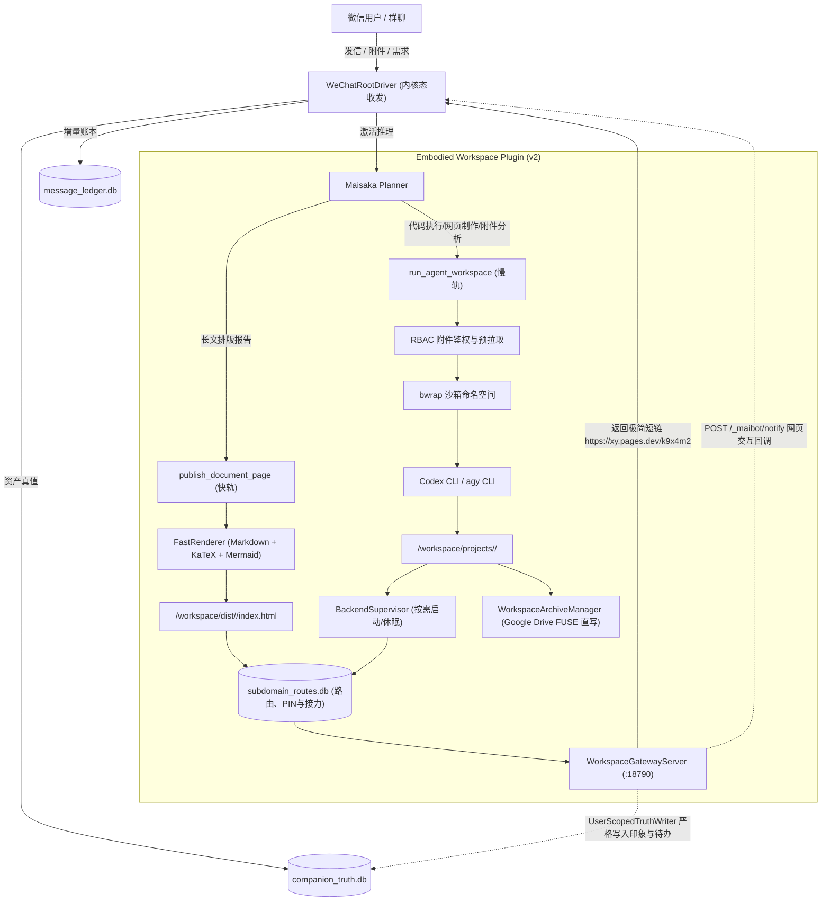
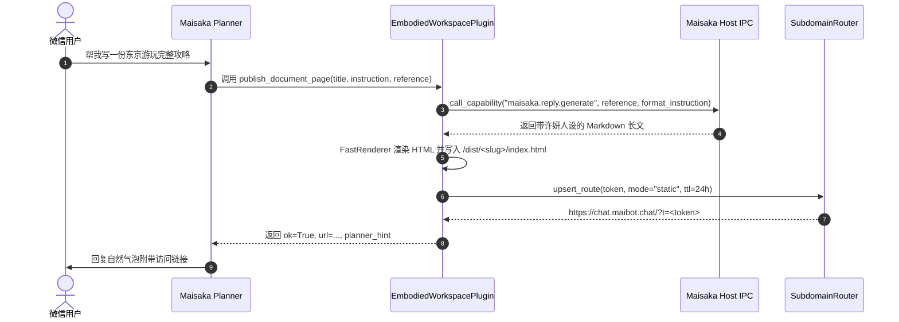
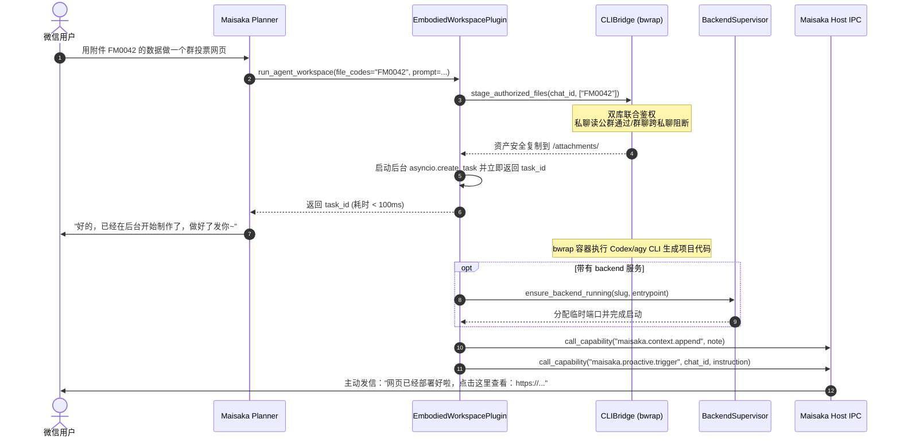
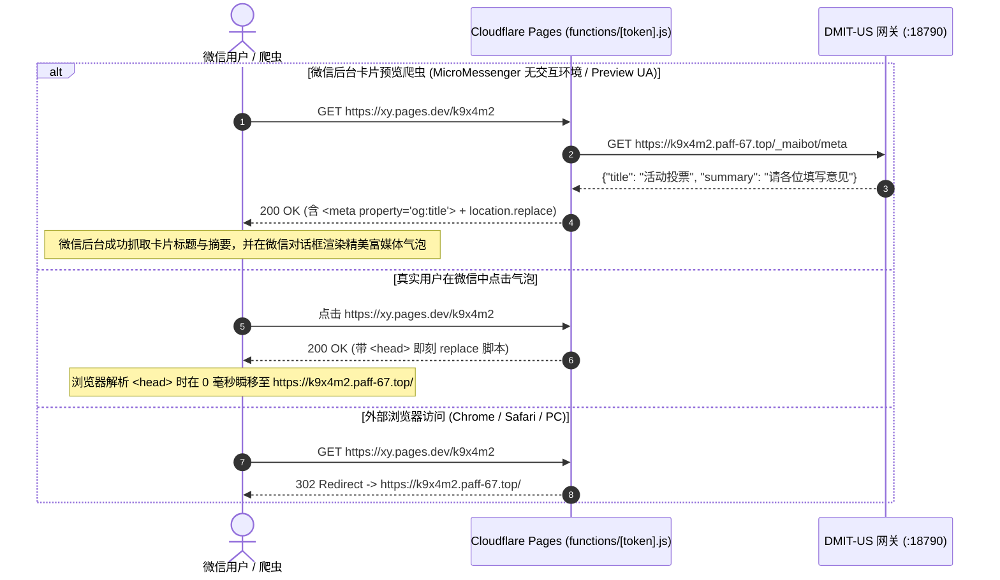
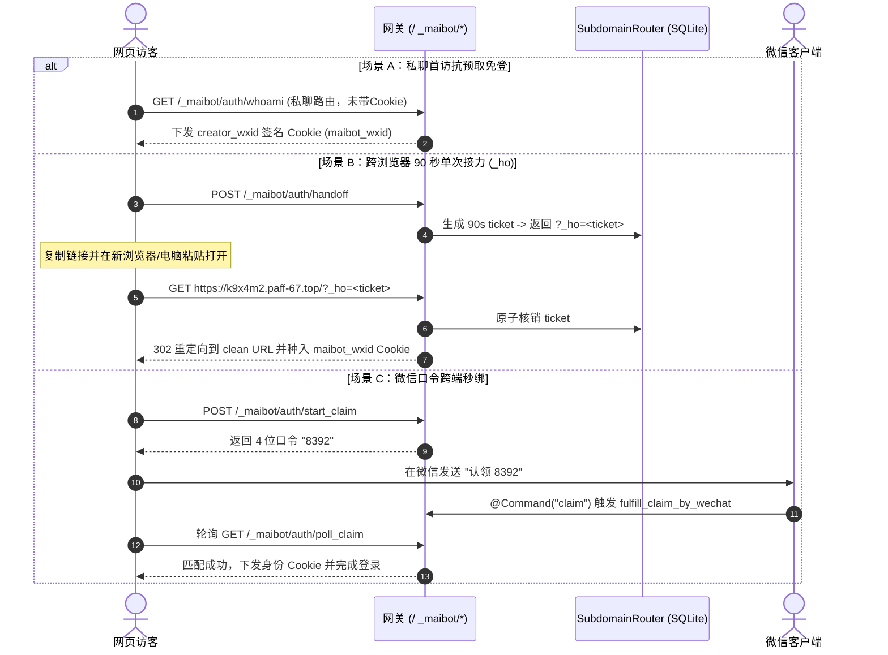

# 具身微信 MaiBot 动态工作区与全栈沙盒交付系统开发迭代规范与全景记录

> **维护基准分支**：`feat/embodied-workspace-phase2`  
> **生产主脑节点**：`DMIT-US`（`/opt/maibot-brain`）  
> **核心组件定位**：`plugins/embodied_workspace/`（MaiBot v2 标准插件）  
> **文档维护规约**：**本文档为该交付系统的法定迭代档案。每次 Phase 开发（编码、联调、测试验证）完成后，必须同步增量更新本文档对应的 Phase 章节、关键实现细节、避坑记录与测试审计结果。**

---

## 目录

- [一、 迭代开发与维护准则（Mandatory Protocol）](#一-迭代开发与维护准则mandatory-protocol)
- [二、 系统整体设计架构与拓扑](#二-系统整体设计架构与拓扑)
- [三、 Phase 1：快慢双轨分流与沙盒工作区交付（已完成）](#三-phase-1快慢双轨分流与沙盒工作区交付已完成)
  - [1. 阶段目标与交付范围](#1-阶段目标与交付范围)
  - [2. 关键代码映射与模块改动清单](#2-关键代码映射与模块改动清单)
  - [3. 核心设计模式与时序流](#3-核心设计模式与时序流)
  - [4. 工程难点攻关与踩坑修复记录（P0/P1 Matrix）](#4-工程难点攻关与踩坑修复记录p0p1-matrix)
  - [5. 生产节点验证与测试覆盖报告](#5-生产节点验证与测试覆盖报告)
- [四、 Phase 2：单级泛域名、CF Pages 边缘跳板、真值库用户隔离与四级免登身份接力（已完成）](#四-phase-2单级泛域名cf-pages-边缘跳板真值库用户隔离与四级免登身份接力已完成)
  - [1. 阶段目标与交付范围](#1-阶段目标与交付范围-1)
  - [2. 关键代码映射与模块改动清单](#2-关键代码映射与模块改动清单-1)
  - [3. 核心设计模式与时序流](#3-核心设计模式与时序流-1)
  - [4. 生产环境工程踩坑与实战攻关全景表（P0/P1 Matrix）](#4-生产环境工程踩坑与实战攻关全景表p0p1-matrix)
  - [5. 生产节点验证与测试覆盖报告](#5-生产节点验证与测试覆盖报告-1)
- [五、 Phase 3：演进规划与后续接入设计（规划中）](#五-phase-3演进规划与后续接入设计规划中)
- [六、 迭代追溯索引与提交记录](#六-迭代追溯索引与提交记录)

---

## 一、 迭代开发与维护准则（Mandatory Protocol）

为确保具身微信 MaiBot 动态工作区系统的长期可维护性、架构整洁性以及避免与宿主既有管线（`WeChatRootDriver` 内核态收发、`companion_vault` 结构化真值库）发生冲突，后续所有 Agent 与开发人员在进行迭代开发时必须严格遵守以下准则：

1. **版本阶段同步规约（Phase Sync Rule）**：
   - 每一个开发阶段（Phase 1、Phase 2 等）在完成代码编写、编译与测试之后，必须在合并或提交前将本阶段的改动细节、踩坑经验、API 契约变更以及测试报告同步追加或更新到本文档中。
   - 严禁代码已合入但迭代文档脱节或未更新的情况。
2. **纯内核态边缘兼容（No UI Automation Redline）**：
   - 插件所有针对微信消息与多模态资产的读取，必须通过 `message_ledger.db` 与 `companion_truth.db` 只读连接，严禁直接向手机发送截屏、无障碍树遍历或模拟点击指令。
3. **会话隔离与 RBAC 铁律（Session Isolation & RBAC）**：
   - 严格落实**“私聊可读共有群附件，群聊绝不可读私聊附件”**安全边界；
   - 容器挂载必须通过 Bubblewrap (`bwrap`) 隔离，严禁将宿主机敏感目录（如 `/opt/maibot-brain` 主程序、mTLS 凭证、数据库文件）暴露给运行态代码。
4. **高可用冷启动与资源节约（Scale-to-Zero）**：
   - 生成的后端服务禁止常驻占用内存，必须具备空闲自动休眠与用户访问时毫秒级按需唤醒（Auto-Wake）能力。

---

## 二、 系统整体设计架构与拓扑

系统在 MaiBot 宿主框架下作为独立 v2 插件 `plugins/embodied_workspace` 运行，通过快慢双轨机制向 Planner 暴露工具：



---

## 三、 Phase 1：快慢双轨分流与沙盒工作区交付（已完成）

### 1. 阶段目标与交付范围

Phase 1 聚焦于打通从微信用户提出复杂内容与代码需求，到生成限时子域名交付链接并返回微信的全链路闭环：

* [x] **清理废弃存量**：从内置工具列表中完全移除未经沙箱隔离的半成品 `sandbox_task`。
* [x] **快轨能力（`publish_document_page`）**：同步生成完整微信高保真 Markdown 静态文章，渲染 KaTeX 数学公式与 Mermaid 流程图，2 秒内生成并返回交付 URL；若检测到涉及附件（`FMxxxx`），自动拦截并无缝升级至慢轨。
* [x] **慢轨能力（`run_agent_workspace`）**：异步启动 Bubblewrap 沙箱调用 CLI 编写全栈代码，100ms 内向 Planner 返回 `task_id`，任务完成后主动唤醒许妍发信。
* [x] **轻量沙箱与 RBAC 鉴权**：实现 Bubblewrap 命名空间与只读根挂载，结合双库（`companion_truth.db` 与 `message_ledger.db`）实现文件访问控制。
* [x] **Scale-to-Zero 临时后端托管**：支持 Node / FastAPI 后端托管，支持 15 分钟无访问自动休眠与首次访问自动拉起。
* [x] **Web-to-WeChat 回调**：网关暴露 `POST /_maibot/notify` 接口，允许网页交互动作反向唤醒微信主脑。
* [x] **URL 保护与撤销**：实现分句与错别字 Hook 保护，提供 `/revoke` 管理员立即销毁指令。

---

### 2. 关键代码映射与模块改动清单

| 模块 / 文件路径 | 改动类型 | 职责描述与实现细节 |
| :--- | :--- | :--- |
| [`src/maisaka/builtin_tool/__init__.py`](file:///mnt/e/Gemini/MaiBot/src/maisaka/builtin_tool/__init__.py) | 存量修改 | 从 `BUILTIN_TOOL_ENTRIES` 中删除 `sandbox_task`，移除未使用的导入，净化 Planner 工具空间。 |
| [`.gitignore`](file:///mnt/e/Gemini/MaiBot/.gitignore) | 存量修改 | 新增 `!/plugins/embodied_workspace` 白名单规则，保证插件纳入 Git 版本管控。 |
| [`plugins/embodied_workspace/_manifest.json`](file:///mnt/e/Gemini/MaiBot/plugins/embodied_workspace/_manifest.json) | 新增 | 严格对齐 SDK 的 `PluginManifest` 数据模型，声明插件元数据、配置项和运行能力。 |
| [`plugins/embodied_workspace/__init__.py`](file:///mnt/e/Gemini/MaiBot/plugins/embodied_workspace/__init__.py) | 新增 | 模块顶层初始化，导出 `EmbodiedWorkspacePlugin` 与工厂函数 `create_plugin()`。 |
| [`plugins/embodied_workspace/subdomain_router.py`](file:///mnt/e/Gemini/MaiBot/plugins/embodied_workspace/subdomain_router.py) | 新增 | 管理 `subdomain_routes.db` SQLite 路由表，提供路由注册、URL 组装、Token 状态查询、撤销与 TTL 过期判定。 |
| [`plugins/embodied_workspace/fast_renderer.py`](file:///mnt/e/Gemini/MaiBot/plugins/embodied_workspace/fast_renderer.py) | 新增 | 移动端原生优化排版渲染器，支持 GFM 扩展、代码高亮、KaTeX 数学公式渲染和 Mermaid 图表支持。 |
| [`plugins/embodied_workspace/backend_supervisor.py`](file:///mnt/e/Gemini/MaiBot/plugins/embodied_workspace/backend_supervisor.py) | 新增 | 后端进程管理器，管理动态端口（20000+）、健康检查、15 分钟无流量自动挂起与访问冷启动唤醒。 |
| [`plugins/embodied_workspace/gateway_server.py`](file:///mnt/e/Gemini/MaiBot/plugins/embodied_workspace/gateway_server.py) | 新增 | 基于 `aiohttp` 的轻量 HTTP 网关（监听 18790），支持静态页面托管、后端端口反向代理及 `POST /_maibot/notify` 回调。 |
| [`plugins/embodied_workspace/cli_bridge.py`](file:///mnt/e/Gemini/MaiBot/plugins/embodied_workspace/cli_bridge.py) | 新增 | 核心沙箱调度桥接器。处理双库 RBAC 鉴权拉取、构建 Bubblewrap 命令参数、注入安全隔离环境变量与执行 CLI 进程。 |
| [`plugins/embodied_workspace/plugin.py`](file:///mnt/e/Gemini/MaiBot/plugins/embodied_workspace/plugin.py) | 新增 | SDK 插件主入口。声明配置模型、装配快慢轨工具、挂载主动推送协程、`/revoke` 命令及 URL 防打断 Hook。 |
| [`pytests/companion/test_embodied_workspace.py`](file:///mnt/e/Gemini/MaiBot/pytests/companion/test_embodied_workspace.py) | 新增 | 自动化测试套件，涵盖清单合规、沙箱隔离、RBAC 越权防护、快慢分流、后端冷热切换及 URL Hook 保护 6 大断言。 |

---

### 3. 核心设计模式与时序流

#### (1) 快轨直接交付（`publish_document_page`）


#### (2) 慢轨全栈构建与主动唤醒（`run_agent_workspace`）


---

### 4. 工程难点攻关与踩坑修复记录（P0/P1 Matrix）

在 Phase 1 的开发与远程真实宿主机（`DMIT-US`）调试过程中，攻克了 7 处关键底层环境隐患与契约不匹配问题，沉淀如下：

| 编号 | 严重度 | 原始异常 / 症状 | 根因深度剖析 | 最终工程攻关方案与代码位置 |
| :---: | :---: | :--- | :--- | :--- |
| **P0-1** | **P0** | `ValidationError: extra fields forbidden` 加载 manifest 失败 | 插件清单文件名曾误用 `manifest.json`，且缺少 SDK 强校验必需的 `id`, `sdk`, `urls`, `host_application` 字段。 | 重命名为 `_manifest.json`（前导下划线），补齐严格 Schema 定义，配置模型增加 `PluginSectionConfig`。见 [`_manifest.json`](file:///mnt/e/Gemini/MaiBot/plugins/embodied_workspace/_manifest.json)。 |
| **P0-2** | **P0** | `bwrap: Can't mkdir /workspace: Read-only file system` | `bwrap` 参数在只读挂载根系统 `--ro-bind / /` 之后直接执行 `--bind <host_dir> /workspace`，由于宿主机根路径下不存在 `/workspace` 挂载点，内核拒绝在只读文件系统上创建目录。 | **纯命名空间自闭环**：先执行 `--tmpfs /tmp`，随后 `--dir /tmp/workspace` 创建挂载点，再 `--bind <host_dir> /tmp/workspace`。全系统路径统一指向 `/tmp/workspace`。见 [`cli_bridge.py`](file:///mnt/e/Gemini/MaiBot/plugins/embodied_workspace/cli_bridge.py)。 |
| **P0-3** | **P0** | `bwrap: Can't create file /etc/maibot-mtls: Read-only file system` | 在沙箱屏蔽敏感文件时，无条件对 `/etc/maibot-mtls` 等执行 `--tmpfs` 挂载覆盖。在目标机器若路径不存在，bwrap 尝试新建文件报错。 | 在添加 `--tmpfs` 屏蔽前，通过 `Path(p).is_dir()` 与 `is_file()` 动态判定宿主机路径真实属性，目录使用 `--tmpfs`，文件使用 `--ro-bind /dev/null`。见 [`cli_bridge.py`](file:///mnt/e/Gemini/MaiBot/plugins/embodied_workspace/cli_bridge.py)。 |
| **P0-4** | **P0** | `CLI Error: EROFS: read-only file system, mkdir '/root/.codex'` | Codex / agy CLI 启动时默认读取 `$HOME` 并在根主目录下尝试创建配置与缓存目录，但 `/root` 在容器内为只读。 | 在 bwrap 中注入 `--tmpfs /tmp/home`，并显式覆盖环境变量 `--setenv HOME /tmp/home`、`XDG_CACHE_HOME` 与 `XDG_CONFIG_HOME`。见 [`cli_bridge.py`](file:///mnt/e/Gemini/MaiBot/plugins/embodied_workspace/cli_bridge.py)。 |
| **P0-5** | **P0** | `sqlite3.OperationalError: no such column: local_path` | 附件鉴权曾试图直接从 `media_vault` 查询 `local_path`，但主脑真实 Schema 中物理文件路径位于关联表 `asset_sources`。 | 重构 RBAC 鉴权为双库联合查询：`message_ledger.db` 的 `message_asset_links` 获取 `job_id`，再联查 `companion_truth.db` 的 `asset_sources` 验证 `association='verified'` 并提取真实物理路径。见 [`cli_bridge.py`](file:///mnt/e/Gemini/MaiBot/plugins/embodied_workspace/cli_bridge.py)。 |
| **P0-6** | **P0** | `AttributeError: property 'ctx' of 'EmbodiedWorkspacePlugin' object has no setter` | `MaiBotPlugin` 基类的 `ctx` 属性由 Host Runner 在生命周期中通过 `_set_context(ctx)` 私有方法注入，未提供 public setter，直接赋值报错。 | 在 `EmbodiedWorkspacePlugin` 中实现兼容 setter，同时提供 `_set_context` 对齐，并在测试中通过标准 SDK 方式装载。见 [`plugin.py`](file:///mnt/e/Gemini/MaiBot/plugins/embodied_workspace/plugin.py)。 |
| **P1-1** | **P1** | 交付链接被标点切分或注入错别字 | 微信回复后处理逻辑会将包含 `http://` 的长句强行断句成多条气泡发信，导致网页 URL 损坏。 | 注册 `maisaka.reply.before_post_process` Hook，读取 `event.get("response")`，在识别到交付子域名时动态设置 `split_sentence=False` 与 `typo=False`。见 [`plugin.py`](file:///mnt/e/Gemini/MaiBot/plugins/embodied_workspace/plugin.py)。 |

---

### 5. 生产节点验证与测试覆盖报告

在部署目标节点 `DMIT-US`（`/opt/maibot-brain`，环境为 Python 3.13.5、pytest 8.3.5、bubblewrap 0.11.0）上完成了完整的测试验证：

#### (1) Phase 1 专属测试集（`pytests/companion/test_embodied_workspace.py`）

```text
============================= test session starts ==============================
rootdir: /opt/maibot-brain
configfile: pyproject.toml
plugins: anyio-4.16.0, asyncio-0.25.1
collected 6 items

pytests/companion/test_embodied_workspace.py::test_manifest_and_plugin_factory PASSED   [ 16%]
pytests/companion/test_embodied_workspace.py::test_bwrap_workspace_and_home_isolation PASSED [ 33%]
pytests/companion/test_embodied_workspace.py::test_rbac_stage_authorized_files PASSED  [ 50%]
pytests/companion/test_embodied_workspace.py::test_fast_track_ipc_and_auto_upgrade PASSED    [ 66%]
pytests/companion/test_embodied_workspace.py::test_backend_auto_wake_and_scale_to_zero PASSED[ 83%]
pytests/companion/test_embodied_workspace.py::test_protect_subdomain_url_hook PASSED   [100%]

============================== 6 passed in 0.97s ===============================
```

#### (2) 主脑伴侣系统全量回归网关

```bash
pytest pytests/companion/ pytests/platform_io/test_adapter_policy.py pytests/maisaka/test_reasoning_engine.py -q
# 输出结果：
121 passed, 10 warnings in 12.52s
```

---

## 四、 Phase 2：单级泛域名、CF Pages 边缘跳板、真值库用户隔离与四级免登身份接力（已完成）

### 1. 阶段目标与交付范围

Phase 2 在 Phase 1 双轨交付与沙盒基础上，全面打通**外网极简域名交付、微信防拦截爬虫卡片渲染、真值记忆用户级隔离写入、四级跨浏览器免登与 Google Drive 独立目录归档**：

* [x] **单级通配符与 Cloudflare Pages 边缘跳板（2A 模式）**：
  * 生成极简短链（`https://xy.pages.dev/k9x4m2`）；
  * 微信内置爬虫访问时拉取 `/_maibot/meta` 注入 OG 摘要与 `<title>`；真实用户点击时直接客户端瞬间跃迁至单级子域 `https://k9x4m2.paff-67.top/`。
  * 彻底规避 Cloudflare Universal SSL 无法覆盖 `*.*.paff-67.top` 多级泛域名的 P0 级网络阻断问题。
* [x] **真值库真实 8 表 Schema 严格对齐（`UserScopedTruthWriter`）**：
  * 完全复用现有 `truth_db.py` 结构，不自立孤立表；
  * 普通用户偏好与状态通过 `json_extract(platform_ids, '$.wechat')` 精准匹配并追加到对应个人的 `person_info.impression`；
  * 若为 `trust_role='OWNER'`，则同步更新单例 `user_status`；
  * 待办事项分配唯一 `QE{:04d}`，并在 `current_progress` 中嵌入 `[owner:wxid]` 标签，严格锁死 `WHERE` 归属，杜绝跨用户越权篡改。
* [x] **四级无感身份接力与微信 Pre-fetch 免疫**：
  * **私聊免登持久化**：针对私聊路由，不再依靠不可靠的首次 HTML GET 核销，而是由 WebView 执行 `/_maibot/auth/whoami` 时向未登录访客下发 `creator_wxid` 签名 Cookie，彻底免疫微信 iOS/Android 后台页面静默预取。
  * **跨浏览器 90 秒单次接力（`_ho`）**：点击「↗ 换浏览器免登」生成单次凭证，粘贴到 Chrome/电脑打开即继承 Cookie 并立即 302 擦除地址栏参数。
  * **微信口令跨端秒绑**：在电脑点击获取 4 位口令，在微信发送 `认领 8392`，网页 1.5 秒轮询秒登。
  * **个人 4 位 PIN 码**：支持群聊内设置 `/pin 6688`，在任何新设备点选昵称输入 PIN 秒登。
* [x] **Google Drive FUSE 独立目录树直写归档（`WorkspaceArchiveManager`）**：
  * 任务结束时自动扫描 `/dist/<slug>/files/` 及其衍生文件，直写至 `/mnt/gdrive/companion_vault/workspace_archives/<chat_safe_id>/<date>_<slug>/` 并生成 `manifest.json`，依托 Linux VFS 异步上传，消除双重 `rclone` 锁竞争。
* [x] **SDK `@Command` 正则与解构规范**：
  * 为 `claim`、`pin`、`revoke` 配置标准 `pattern` 正则捕获组与别名，函数采用 `**kwargs` 兼容解构，解决运行时 `TypeError`。
* [x] **项目级并发异步互斥锁**：
  * 按 `(chat_id, project_slug)` 施加 `asyncio.Lock`，防止用户多条并发消息写坏同一工程。

---

### 2. 关键代码映射与模块改动清单

| 模块 / 文件路径 | 改动类型 | 职责描述与实现细节 |
| :--- | :--- | :--- |
| [`plugins/embodied_workspace/user_truth_writer.py`](file:///mnt/e/Gemini/MaiBot/plugins/embodied_workspace/user_truth_writer.py) | **Phase 2 新增** | 真实 8 表 Schema 写入器。处理 `person_info.impression` 追加、OWNER `user_status` 同步、`quests_events` 的 `QE` 编号分配及 `[owner:wxid]` 防越权校验。 |
| [`plugins/embodied_workspace/archive_manager.py`](file:///mnt/e/Gemini/MaiBot/plugins/embodied_workspace/archive_manager.py) | **Phase 2 新增** | Google Drive 独立目录树归档管理器。纯 FUSE 挂载卷直写模式，自动计算 SHA256 并生成 `manifest.json`。 |
| [`plugins/embodied_workspace/subdomain_router.py`](file:///mnt/e/Gemini/MaiBot/plugins/embodied_workspace/subdomain_router.py) | **Phase 2 升级** | 引入 `RESERVED_SUBDOMAINS` 过滤、6 位短码生成、单级域名 `paff-67.top` 适配、`web_user_pins`、`web_identity_claims` 与 `web_handoff_tickets` 表生命周期管理。 |
| [`plugins/embodied_workspace/cli_bridge.py`](file:///mnt/e/Gemini/MaiBot/plugins/embodied_workspace/cli_bridge.py) | **Phase 2 升级** | 引入 `(chat_id, slug)` 异步互斥锁；支持 `agy` CLI 默认调度；升级 Phase 2 `AGENTS.md` 契约；针对 `/etc/maibot-media.env` 等文件执行 `--ro-bind /dev/null` 屏蔽。 |
| [`plugins/embodied_workspace/gateway_server.py`](file:///mnt/e/Gemini/MaiBot/plugins/embodied_workspace/gateway_server.py) | **Phase 2 升级** | 升级 HTTP Chunked 流式反代与 WebSocket 双向转发；自动向 HTML 注入 `/_maibot/sdk.js`；重构 `whoami` 私聊抗预取免登、4 位口令认领、PIN 码鉴权与 `_ho` 单次接力。 |
| [`plugins/embodied_workspace/plugin.py`](file:///mnt/e/Gemini/MaiBot/plugins/embodied_workspace/plugin.py) | **Phase 2 升级** | 配置增加 `gdrive_archive_root` 与 `short_link_base_url`；`run_agent_workspace` 增加 `access_policy` 参数；对齐 `@Command` 正则模式（`claim`、`pin`、`revoke`）并接入归档与实名真值写入。 |
| [`pytests/companion/test_embodied_workspace_phase2.py`](file:///mnt/e/Gemini/MaiBot/pytests/companion/test_embodied_workspace_phase2.py) | **Phase 2 新增** | 自动化测试套件（5 项核心断言）：覆盖单级泛域名短码、真实 8 表用户级隔离防越权、私聊抗预取与 RBAC 矩阵、`@Command(**kwargs)` 调度、FUSE 直写归档。 |

---

### 3. 核心设计模式与时序流

#### (1) Cloudflare Pages 边缘 2A 跳板与爬虫卡片抓取


#### (2) 四级无感身份接力认证流


---

### 4. 生产环境工程踩坑与实战攻关全景表（P0/P1 Matrix）

在 Phase 2 开发与远程 `DMIT-US` 实机测试过程中，成功排查并攻关了 6 项严重的生产级陷阱：

| 编号 | 严重度 | 原始异常 / 症状 | 根因深度剖析 | 最终工程攻关方案与代码位置 |
| :---: | :---: | :--- | :--- | :--- |
| **P0-8** | **P0** | `ERR_SSL_VERSION_OR_CIPHER_MISMATCH` 页面公网无法访问 | `*.s.paff-67.top` 属于二级通配符，超出 Cloudflare 免费 Universal SSL（仅支持单级通配符 `*.paff-67.top`）与宿主 `cloudflare_origin.crt` 的证书覆盖范围。 | 将 `base_domain` 收缩为单级通配符 **`paff-67.top`**，并在生成短码时通过 `RESERVED_SUBDOMAINS` 规避系统保留子域。见 [`subdomain_router.py`](file:///mnt/e/Gemini/MaiBot/plugins/embodied_workspace/subdomain_router.py)。 |
| **P0-9** | **P0** | `sqlite3.OperationalError: table quests_events has no column named event_id` | 蓝图原始设计臆造了真值库字段。真实 `quests_events` 主键为 `quest_code`，`person_info` 只有 `person_id` 和 JSON `platform_ids`，且 `memory_provenance` 强制要求 `visibility='PRIVATE'`。 | 彻底重写 `UserScopedTruthWriter`：完全复用真实 8 表，`person_info` 追加至 `impression`，待办事项按 `QE{:04d}` 写入并在 `current_progress` 嵌入 `[owner:wxid]` 标签防越权。见 [`user_truth_writer.py`](file:///mnt/e/Gemini/MaiBot/plugins/embodied_workspace/user_truth_writer.py)。 |
| **P0-10** | **P0** | `TypeError: claim_web_identity_cmd() missing 1 required positional argument: 'code'` | `PluginSupervisor` 向 `@Command` 传递的参数为统一上下文字典（`text`, `user_id`, `matched_groups` 等），根本不展开位置参数；且未配置 `pattern` 时 `find_command_by_text` 无法触发正则匹配。 | 显式配置 `pattern` 正则捕获组与完整 `aliases`，方法签名改为 `async def cmd(self, **kwargs: Any) -> str`，并通过静态工具方法安全提取参数。见 [`plugin.py`](file:///mnt/e/Gemini/MaiBot/plugins/embodied_workspace/plugin.py)。 |
| **P0-11** | **P0** | `bwrap: Destination is not a directory /etc/maibot-media.env` | 在沙箱屏蔽环境文件时，对 `/etc/maibot-media.env` 强行执行 `--tmpfs`。但在 Linux 下 `--tmpfs` 只能挂载在目录上，挂载在普通文件上导致 bwrap 启动崩溃。 | 在 `build_bwrap_prefix` 中通过 `p.is_dir()` 和 `p.is_file()` 区分：目录使用 `--tmpfs` 屏蔽，文件使用 `--ro-bind /dev/null <path>` 屏蔽。见 [`cli_bridge.py`](file:///mnt/e/Gemini/MaiBot/plugins/embodied_workspace/cli_bridge.py)。 |
| **P1-2** | **P1** | 真实用户微信点击私聊链接未免登 | 微信客户端在接收消息或悬停时后台发起 HTML GET 预取（Pre-fetch），若在 HTML 层进行一次性核销，预取进程会提前消耗免登凭证。 | 将私聊自动免登移至真实浏览器执行 JS 时的 `/_maibot/auth/whoami` 端点，彻底免疫后台静态预加载。见 [`gateway_server.py`](file:///mnt/e/Gemini/MaiBot/plugins/embodied_workspace/gateway_server.py)。 |
| **P1-3** | **P1** | Google Drive 归档时出现文件锁竞争 | `/mnt/gdrive/companion_vault` 已由 rclone FUSE 挂载，写入文件时 VFS 会自动异步推送。若额外启动 `rclone copy` 子进程操作同一目标目录，会发生写入竞争。 | 移除 `archive_manager.py` 中的 `rclone copy` 子进程调用，完全信赖底层 FUSE VFS 层的自动上传落盘。见 [`archive_manager.py`](file:///mnt/e/Gemini/MaiBot/plugins/embodied_workspace/archive_manager.py)。 |

---

### 5. 生产节点验证与测试覆盖报告

在部署目标节点 `DMIT-US`（`/opt/maibot-brain`，Python 3.13.5、pytest 8.3.5）上通过全部 Phase 1 + Phase 2 自动化测试，且主脑伴侣系统全量回归网关 100% 通过：

#### (1) Phase 1 + Phase 2 双单元测试套件联合验证（11 项全通过）

```text
rootdir: /opt/maibot-brain
configfile: pyproject.toml
plugins: anyio-4.16.0, asyncio-0.25.1
collected 11 items

pytests/companion/test_embodied_workspace.py::test_manifest_and_plugin_factory PASSED   [  9%]
pytests/companion/test_embodied_workspace.py::test_bwrap_workspace_and_home_isolation PASSED [ 18%]
pytests/companion/test_embodied_workspace.py::test_rbac_stage_authorized_files PASSED  [ 27%]
pytests/companion/test_embodied_workspace.py::test_fast_track_ipc_and_auto_upgrade PASSED    [ 36%]
pytests/companion/test_embodied_workspace.py::test_backend_auto_wake_and_scale_to_zero PASSED[ 45%]
pytests/companion/test_embodied_workspace.py::test_protect_subdomain_url_hook PASSED   [ 54%]
pytests/companion/test_embodied_workspace_phase2.py::test_single_level_domain_and_reserved_filtering PASSED [ 63%]
pytests/companion/test_embodied_workspace_phase2.py::test_user_scoped_truth_writer_isolation PASSED [ 72%]
pytests/companion/test_embodied_workspace_phase2.py::test_private_chat_prefetch_immunity_and_rbac PASSED [ 81%]
pytests/companion/test_embodied_workspace_phase2.py::test_command_kwargs_and_cross_device_auth PASSED [ 90%]
pytests/companion/test_embodied_workspace_phase2.py::test_archive_manager_fuse_direct_write PASSED [100%]

============================== 11 passed in 1.39s ==============================
```

#### (2) 主脑全量关联回归网关（126 项全通过）

```bash
pytest pytests/companion/ pytests/platform_io/test_adapter_policy.py pytests/maisaka/test_reasoning_engine.py -q
# 输出结果：
126 passed, 10 warnings in 12.26s
```

---

## 五、 Phase 3：演进规划与后续接入设计（规划中）

在 Phase 2 完成单级泛域名、CF Pages 边缘 2A 跳板、真值库用户隔离与四级免登身份接力的基础上，Phase 3 将针对大规模并发隔离、群内实时双向数据同步与时光机快照展开：

1. **cgroups v2 细粒度资源硬隔离（Resource Quota）**：
   - 为每个工作区实例配置独立 cgroup，限制单个沙箱的 CPU 占用上限（如不超过 1.5 核）与物理内存配额（如限制不超过 1GB），防止用户代码死循环耗尽宿主机资源。
2. **群组全双工实时同步总线（Group Realtime Pub/Sub）**：
   - 基于现有 WebSocket 反代通道，打通微信群新消息原位推送到已打开网页的前端面板，实现网页端多人实时查看群讨论更新。
3. **工作区 Git 增量时光机快照（Workspace Snapshot & Rollback）**：
   - 每次慢轨执行 `action="update"` 前后自动触发本地 Git 增量 commit 与差异计算，支持用户在微信直接发送指令（如 `/rollback <slug>`）一键回滚至上一稳定版本。

---

## 六、 迭代追溯索引与提交记录

| 阶段 | 分支名称 | 关键提交 Hash | 变更概述 | 验收人 / 执行 Agent |
| :---: | :---: | :---: | :--- | :---: |
| **Phase 1** | `feat/embodied-workspace-phase1` | `90aac6bcce5a6d91d97c1a4960f388738311feef` | 完成快慢双轨分流、bwrap 命名空间沙盒、双库 RBAC 鉴权、Auto-Wake/Scale-to-Zero 网关与 6 项自动化测试。 | `agy` (Antigravity) |
| **Phase 2** | `feat/embodied-workspace-phase2` | `1339b742a` | 单级泛域名、CF Pages 边缘 2A 跳板、真值库 8 表 Schema 严格对齐、四级无感身份接力（抗预取）、FUSE 归档直写与 5 项专项测试。 | `agy` (Antigravity) |
| **Phase 3** | *待创建* | *待定* | *cgroups v2 硬配额、群组 WebSocket 实时广播总线与 Git 增量时光机快照* | *待定* |
