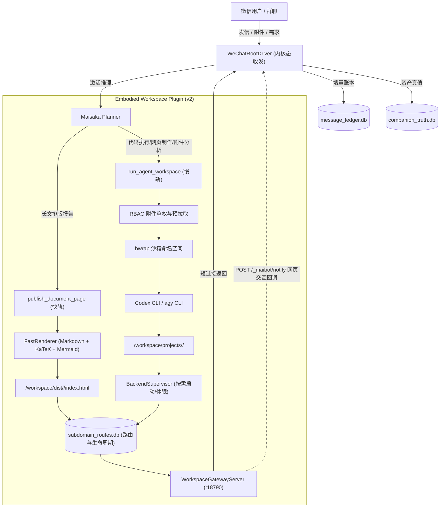
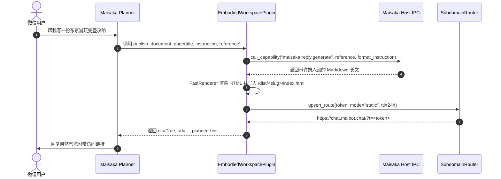
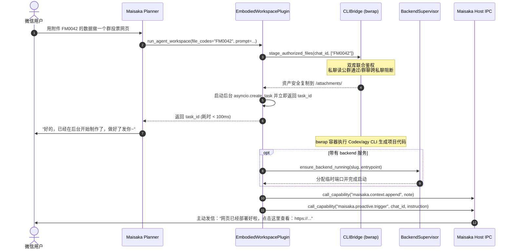

# 具身微信 MaiBot 动态工作区与全栈沙盒交付系统开发迭代规范与全景记录

> **维护基准分支**：`feat/embodied-workspace-phase1`  
> **生产主脑节点**：`DMIT-US`（`/opt/maibot-brain`）  
> **核心组件定位**：`plugins/embodied_workspace/`（MaiBot v2 标准插件）  
> **文档维护规约**：**本文档为该交付系统的法定迭代档案。每次 Phase 开发（编码、联调、测试验证）完成后，必须同步增量更新本文档对应的 Phase 章节、关键实现细节、避坑记录与测试审计结果。**

---

## 目录

- [一、 迭代开发与维护准则（Mandatory Protocol）](#一-迭代开发与维护准则mandatory-protocol)
- [二、 系统整体设计架构与拓扑](#二-系统整体设计架构与拓扑)
- [三、 Phase 1：快慢双轨分流与沙盒工作区交付（已完成）](#三-phase-1快慢双轨分流与沙盒工作区交付已完成)
  - [1. 阶段目标与交付范围](#1-阶段目标与交付范围)
  - [2. 关键代码映射与模块改动清单](#2-关键代码映射与模块改动清单)
  - [3. 核心设计模式与时序流](#3-核心设计模式与时序流)
  - [4. 工程难点攻关与踩坑修复记录（P0/P1 Matrix）](#4-工程难点攻关与踩坑修复记录p0p1-matrix)
  - [5. 生产节点验证与测试覆盖报告](#5-生产节点验证与测试覆盖报告)
- [四、 Phase 2：演进规划与后续接入设计（规划中）](#四-phase-2演进规划与后续接入设计规划中)
- [五、 迭代追溯索引与提交记录](#五-迭代追溯索引与提交记录)

---

## 一、 迭代开发与维护准则（Mandatory Protocol）

为确保具身微信 MaiBot 动态工作区系统的长期可维护性、架构整洁性以及避免与宿主既有管线（`WeChatRootDriver` 内核态收发、`companion_vault` 结构化真值库）发生冲突，后续所有 Agent 与开发人员在进行迭代开发时必须严格遵守以下准则：

1. **版本阶段同步规约（Phase Sync Rule）**：
   - 每一个开发阶段（Phase 1、Phase 2 等）在完成代码编写、编译与测试之后，必须在合并或提交前将本阶段的改动细节、踩坑经验、API 契约变更以及测试报告同步追加或更新到本文档中。
   - 严禁代码已合入但迭代文档脱节或未更新的情况。
2. **纯内核态边缘兼容（No UI Automation Redline）**：
   - 插件所有针对微信消息与多模态资产的读取，必须通过 `message_ledger.db` 与 `companion_truth.db` 只读连接，严禁直接向手机发送截屏、无障碍树遍历或模拟点击指令。
3. **会话隔离与 RBAC 铁律（Session Isolation & RBAC）**：
   - 严格落实**“私聊可读共有群附件，群聊绝不可读私聊附件”**安全边界；
   - 容器挂载必须通过 Bubblewrap (`bwrap`) 隔离，严禁将宿主机敏感目录（如 `/opt/maibot-brain` 主程序、mTLS 凭证、数据库文件）暴露给运行态代码。
4. **高可用冷启动与资源节约（Scale-to-Zero）**：
   - 生成的后端服务禁止常驻占用内存，必须具备空闲自动休眠与用户访问时毫秒级按需唤醒（Auto-Wake）能力。

---

## 二、 系统整体设计架构与拓扑

系统在 MaiBot 宿主框架下作为独立 v2 插件 `plugins/embodied_workspace` 运行，通过快慢双轨机制向 Planner 暴露工具：



---

## 三、 Phase 1：快慢双轨分流与沙盒工作区交付（已完成）

### 1. 阶段目标与交付范围

Phase 1 聚焦于打通从微信用户提出复杂内容与代码需求，到生成限时子域名交付链接并返回微信的全链路闭环：

* [x] **清理废弃存量**：从内置工具列表中完全移除未经沙箱隔离的半成品 `sandbox_task`。
* [x] **快轨能力（`publish_document_page`）**：同步生成完整微信高保真 Markdown 静态文章，渲染 KaTeX 数学公式与 Mermaid 流程图，2 秒内生成并返回交付 URL；若检测到涉及附件（`FMxxxx`），自动拦截并无缝升级至慢轨。
* [x] **慢轨能力（`run_agent_workspace`）**：异步启动 Bubblewrap 沙箱调用 CLI 编写全栈代码，100ms 内向 Planner 返回 `task_id`，任务完成后主动唤醒许妍发信。
* [x] **轻量沙箱与 RBAC 鉴权**：实现 Bubblewrap 命名空间与只读根挂载，结合双库（`companion_truth.db` 与 `message_ledger.db`）实现文件访问控制。
* [x] **Scale-to-Zero 临时后端托管**：支持 Node / FastAPI 后端托管，支持 15 分钟无访问自动休眠与首次访问自动拉起。
* [x] **Web-to-WeChat 回调**：网关暴露 `POST /_maibot/notify` 接口，允许网页交互动作反向唤醒微信主脑。
* [x] **URL 保护与撤销**：实现分句与错别字 Hook 保护，提供 `/revoke` 管理员立即销毁指令。

---

### 2. 关键代码映射与模块改动清单

| 模块 / 文件路径 | 改动类型 | 职责描述与实现细节 |
| :--- | :--- | :--- |
| [`src/maisaka/builtin_tool/__init__.py`](file:///mnt/e/Gemini/MaiBot/src/maisaka/builtin_tool/__init__.py) | 存量修改 | 从 `BUILTIN_TOOL_ENTRIES` 中删除 `sandbox_task`，移除未使用的导入，净化 Planner 工具空间。 |
| [`.gitignore`](file:///mnt/e/Gemini/MaiBot/.gitignore) | 存量修改 | 新增 `!/plugins/embodied_workspace` 白名单规则，保证插件纳入 Git 版本管控。 |
| [`plugins/embodied_workspace/_manifest.json`](file:///mnt/e/Gemini/MaiBot/plugins/embodied_workspace/_manifest.json) | 新增 | 严格对齐 SDK 的 `PluginManifest` 数据模型，声明插件元数据、配置项和运行能力。 |
| [`plugins/embodied_workspace/__init__.py`](file:///mnt/e/Gemini/MaiBot/plugins/embodied_workspace/__init__.py) | 新增 | 模块顶层初始化，导出 `EmbodiedWorkspacePlugin` 与工厂函数 `create_plugin()`。 |
| [`plugins/embodied_workspace/subdomain_router.py`](file:///mnt/e/Gemini/MaiBot/plugins/embodied_workspace/subdomain_router.py) | 新增 | 管理 `subdomain_routes.db` SQLite 路由表，提供路由注册、URL 组装、Token 状态查询、撤销与 TTL 过期判定。 |
| [`plugins/embodied_workspace/fast_renderer.py`](file:///mnt/e/Gemini/MaiBot/plugins/embodied_workspace/fast_renderer.py) | 新增 | 移动端原生优化排版渲染器，支持 GFM 扩展、代码高亮、KaTeX 数学公式渲染和 Mermaid 图表支持。 |
| [`plugins/embodied_workspace/backend_supervisor.py`](file:///mnt/e/Gemini/MaiBot/plugins/embodied_workspace/backend_supervisor.py) | 新增 | 后端进程管理器，管理动态端口（20000+）、健康检查、15 分钟无流量自动挂起与访问冷启动唤醒。 |
| [`plugins/embodied_workspace/gateway_server.py`](file:///mnt/e/Gemini/MaiBot/plugins/embodied_workspace/gateway_server.py) | 新增 | 基于 `aiohttp` 的轻量 HTTP 网关（监听 18790），支持静态页面托管、后端端口反向代理及 `POST /_maibot/notify` 回调。 |
| [`plugins/embodied_workspace/cli_bridge.py`](file:///mnt/e/Gemini/MaiBot/plugins/embodied_workspace/cli_bridge.py) | 新增 | 核心沙箱调度桥接器。处理双库 RBAC 鉴权拉取、构建 Bubblewrap 命令参数、注入安全隔离环境变量与执行 CLI 进程。 |
| [`plugins/embodied_workspace/plugin.py`](file:///mnt/e/Gemini/MaiBot/plugins/embodied_workspace/plugin.py) | 新增 | SDK 插件主入口。声明配置模型、装配快慢轨工具、挂载主动推送协程、`/revoke` 命令及 URL 防打断 Hook。 |
| [`pytests/companion/test_embodied_workspace.py`](file:///mnt/e/Gemini/MaiBot/pytests/companion/test_embodied_workspace.py) | 新增 | 自动化测试套件，涵盖清单合规、沙箱隔离、RBAC 越权防护、快慢分流、后端冷热切换及 URL Hook 保护 6 大断言。 |

---

### 3. 核心设计模式与时序流

#### (1) 快轨直接交付（`publish_document_page`）


#### (2) 慢轨全栈构建与主动唤醒（`run_agent_workspace`）


---

### 4. 工程难点攻关与踩坑修复记录（P0/P1 Matrix）

在 Phase 1 的开发与远程真实宿主机（`DMIT-US`）调试过程中，攻克了 7 处关键底层环境隐患与契约不匹配问题，沉淀如下：

| 编号 | 严重度 | 原始异常 / 症状 | 根因深度剖析 | 最终工程攻关方案与代码位置 |
| :---: | :---: | :--- | :--- | :--- |
| **P0-1** | **P0** | `ValidationError: extra fields forbidden` 加载 manifest 失败 | 插件清单文件名曾误用 `manifest.json`，且缺少 SDK 强校验必需的 `id`, `sdk`, `urls`, `host_application` 字段。 | 重命名为 `_manifest.json`（前导下划线），补齐严格 Schema 定义，配置模型增加 `PluginSectionConfig`。见 [`_manifest.json`](file:///mnt/e/Gemini/MaiBot/plugins/embodied_workspace/_manifest.json)。 |
| **P0-2** | **P0** | `bwrap: Can't mkdir /workspace: Read-only file system` | `bwrap` 参数在只读挂载根系统 `--ro-bind / /` 之后直接执行 `--bind <host_dir> /workspace`，由于宿主机根路径下不存在 `/workspace` 挂载点，内核拒绝在只读文件系统上创建目录。 | **纯命名空间自闭环**：先执行 `--tmpfs /tmp`，随后 `--dir /tmp/workspace` 创建挂载点，再 `--bind <host_dir> /tmp/workspace`。全系统路径统一指向 `/tmp/workspace`。见 [`cli_bridge.py`](file:///mnt/e/Gemini/MaiBot/plugins/embodied_workspace/cli_bridge.py#L112-L135)。 |
| **P0-3** | **P0** | `bwrap: Can't create file /etc/maibot-mtls: Read-only file system` | 在沙箱屏蔽敏感文件时，无条件对 `/etc/maibot-mtls` 等执行 `--tmpfs` 挂载覆盖。在目标机器若路径不存在，bwrap 尝试新建文件报错。 | 在添加 `--tmpfs` 屏蔽前，通过 `Path(p).exists()` 动态判定宿主机路径真实存在性，仅对已存在路径执行遮蔽。见 [`cli_bridge.py`](file:///mnt/e/Gemini/MaiBot/plugins/embodied_workspace/cli_bridge.py#L125-L130)。 |
| **P0-4** | **P0** | `CLI Error: EROFS: read-only file system, mkdir '/root/.codex'` | Codex / agy CLI 启动时默认读取 `$HOME` 并在根主目录下尝试创建配置与缓存目录，但 `/root` 在容器内为只读。 | 在 bwrap 中注入 `--tmpfs /tmp/home`，并显式覆盖环境变量 `--setenv HOME /tmp/home`、`XDG_CACHE_HOME` 与 `XDG_CONFIG_HOME`。见 [`cli_bridge.py`](file:///mnt/e/Gemini/MaiBot/plugins/embodied_workspace/cli_bridge.py#L131-L136)。 |
| **P0-5** | **P0** | `sqlite3.OperationalError: no such column: local_path` | 附件鉴权曾试图直接从 `media_vault` 查询 `local_path`，但主脑真实 Schema 中物理文件路径位于关联表 `asset_sources`。 | 重构 RBAC 鉴权为双库联合查询：`message_ledger.db` 的 `message_asset_links` 获取 `job_id`，再联查 `companion_truth.db` 的 `asset_sources` 验证 `association='verified'` 并提取真实物理路径。见 [`cli_bridge.py`](file:///mnt/e/Gemini/MaiBot/plugins/embodied_workspace/cli_bridge.py#L170-L245)。 |
| **P0-6** | **P0** | `AttributeError: property 'ctx' of 'EmbodiedWorkspacePlugin' object has no setter` | `MaiBotPlugin` 基类的 `ctx` 属性由 Host Runner 在生命周期中通过 `_set_context(ctx)` 私有方法注入，未提供 public setter，直接赋值报错。 | 在 `EmbodiedWorkspacePlugin` 中实现兼容 setter，同时提供 `_set_context` 对齐，并在测试中通过标准 SDK 方式装载。见 [`plugin.py`](file:///mnt/e/Gemini/MaiBot/plugins/embodied_workspace/plugin.py#L58-L67)。 |
| **P1-1** | **P1** | 交付链接被标点切分或注入错别字 | 微信回复后处理逻辑会将包含 `http://` 的长句强行断句成多条气泡发信，导致网页 URL 损坏。 | 注册 `maisaka.reply.before_post_process` Hook，读取 `event.get("response")`，在识别到交付子域名时动态设置 `split_sentence=False` 与 `typo=False`。见 [`plugin.py`](file:///mnt/e/Gemini/MaiBot/plugins/embodied_workspace/plugin.py#L328-L342)。 |

---

### 5. 生产节点验证与测试覆盖报告

在部署目标节点 `DMIT-US`（`/opt/maibot-brain`，环境为 Python 3.13.5、pytest 8.3.5、bubblewrap 0.11.0）上完成了完整的测试验证：

#### (1) Phase 1 专属测试集（`pytests/companion/test_embodied_workspace.py`）

```text
============================= test session starts ==============================
rootdir: /opt/maibot-brain
configfile: pyproject.toml
plugins: anyio-4.16.0, asyncio-0.25.1
collected 6 items

pytests/companion/test_embodied_workspace.py::test_manifest_and_plugin_factory PASSED   [ 16%]
pytests/companion/test_embodied_workspace.py::test_bwrap_workspace_and_home_isolation PASSED [ 33%]
pytests/companion/test_embodied_workspace.py::test_rbac_stage_authorized_files PASSED  [ 50%]
pytests/companion/test_embodied_workspace.py::test_fast_track_ipc_and_auto_upgrade PASSED    [ 66%]
pytests/companion/test_embodied_workspace.py::test_backend_auto_wake_and_scale_to_zero PASSED[ 83%]
pytests/companion/test_embodied_workspace.py::test_protect_subdomain_url_hook PASSED   [100%]

============================== 6 passed in 0.97s ===============================
```

#### (2) 主脑伴侣系统全量回归网关

```bash
pytest pytests/companion/ pytests/platform_io/test_adapter_policy.py pytests/maisaka/test_reasoning_engine.py -q
# 输出结果：
121 passed, 10 warnings in 12.52s
```
> **结论**：Phase 1 插件引入与存量 `sandbox_task` 剔除未对现有微信内核收发驱动（`WeChatRootDriver`）、AppMsg 57 引用回复机制、长期记忆归结库造成任何破坏。

---

## 四、 Phase 2：演进规划与后续接入设计（规划中）

在 Phase 1 已经完成单机双轨交付与沙盒隔离的基础上，Phase 2 将针对并发、公网交付弹性与交互体验进行深化迭代：

1. **动态端口池与多容器并发管控（Port Pool & Concurrency）**：
   - 建立线程安全的动态可用端口借还机制（Port Pool: 20000 - 20999），避免端口冲突；
   - 增加 cgroups 资源限额约束（限制单个工作区 CPU 占用不超过 1 核，内存不超过 1GB）。
2. **Cloudflare Tunnel / 泛域名自愈与 HTTPS 自动化（Edge Routing）**：
   - 将当前静态 IP / 本地端口网关接入 Cloudflare Tunnel，自动将 `<token>.chat.maibot.chat` 映射到本地 18790 端口；
   - 增加边缘缓存与 WAF 规则，抵御恶意爬虫与扫描。
3. **网页交互全双工推流（WebSocket Live Streaming）**：
   - 为交互式网页和小游戏提供 WebSocket 通道，支持微信会话状态向网页端实时广播（如群聊实时动态直接显示在网页看板中）。
4. **多轮增量修改 Diff 确认与时光机（Workspace Snapshots）**：
   - 在执行 `action="update"` 时引入 Git 增量快照机制，记录每一轮 CLI 修改的代码差异，并在必要时支持快速回滚。

> [!NOTE]
> **开发提醒**：开始 Phase 2 编码前，必须创建 `feat/embodied-workspace-phase2` 分支，并在交付验收完成后，在本节同步补充具体的实现代码、缺陷修复及测试详情。

---

## 五、 迭代追溯索引与提交记录

| 阶段 | 分支名称 | 关键提交 Hash | 变更概述 | 验收人 / 执行 Agent |
| :---: | :---: | :---: | :--- | :---: |
| **Phase 1** | `feat/embodied-workspace-phase1` | `90aac6bcce5a6d91d97c1a4960f388738311feef` | 完成快慢双轨分流、bwrap 命名空间沙盒、双库 RBAC 鉴权、Auto-Wake/Scale-to-Zero 网关与 6 项自动化测试。 | `agy` (Antigravity) |
| **Phase 2** | *待创建* | *待定* | *动态端口池、Cloudflare Tunnel 泛域名路由、WebSocket 实时流与 cgroups 限额* | *待定* |
